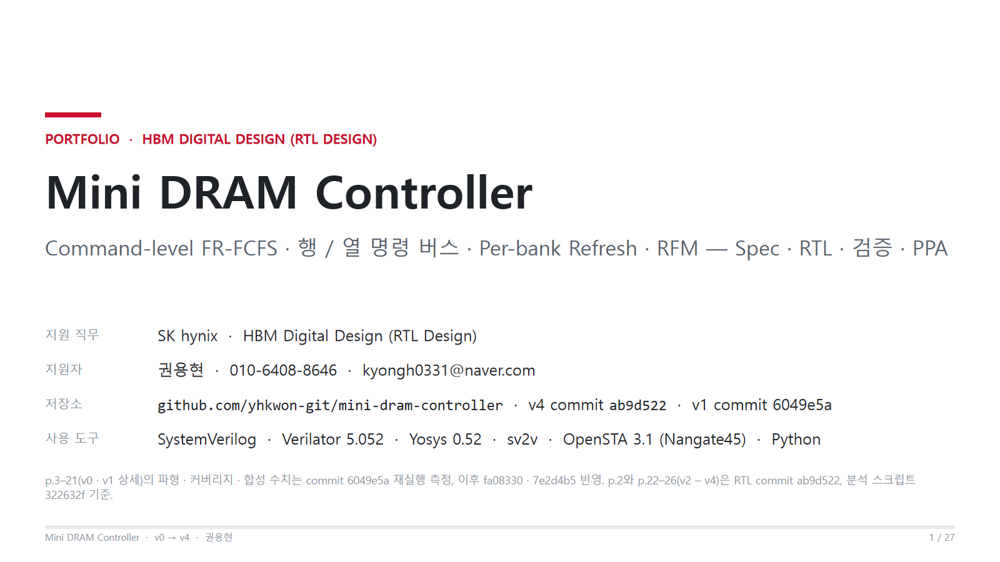
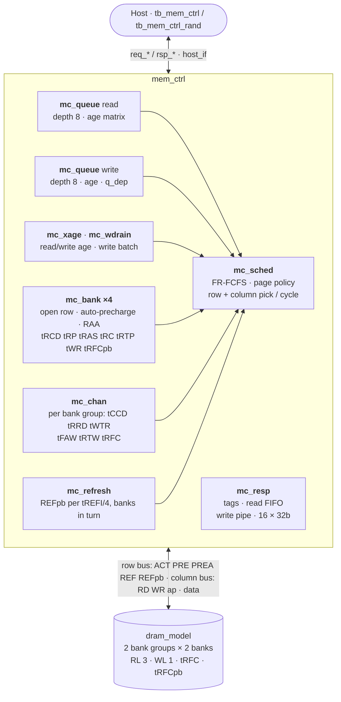
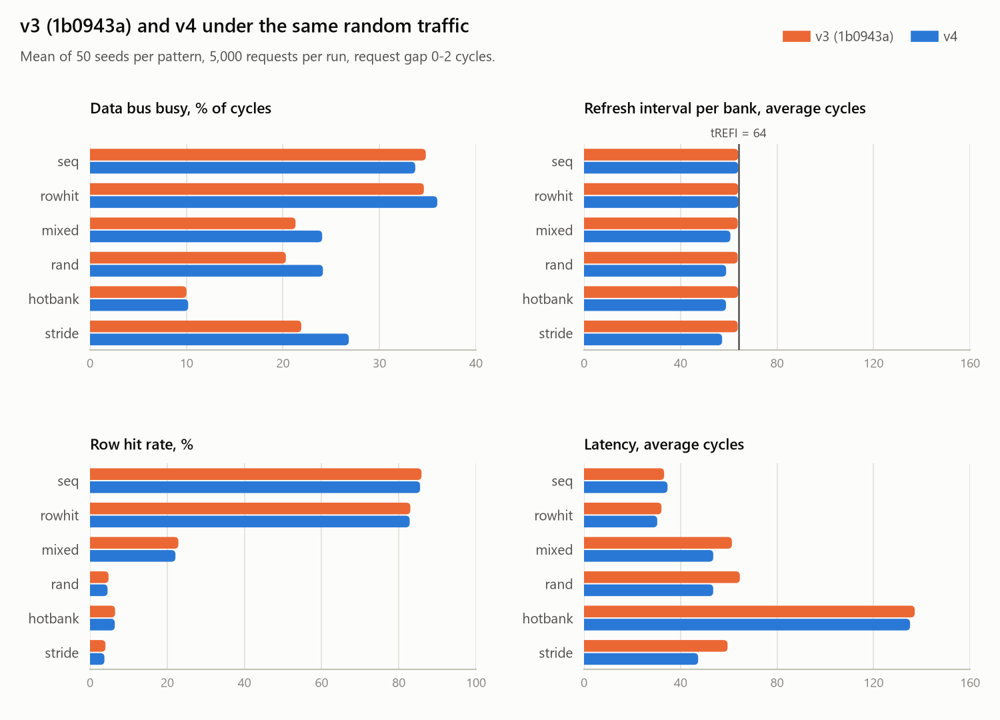
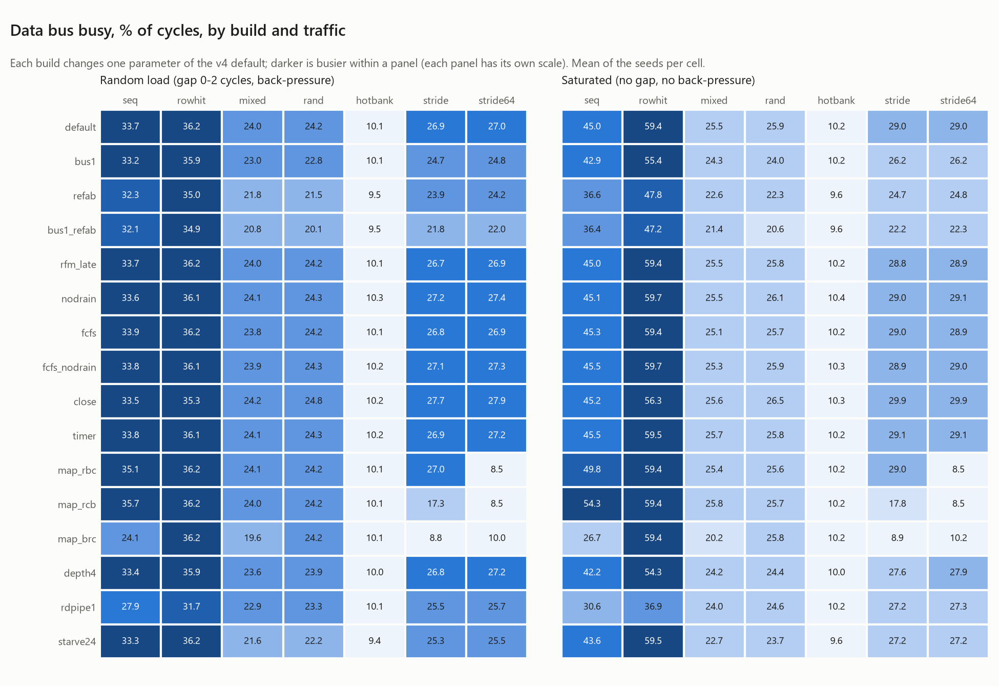
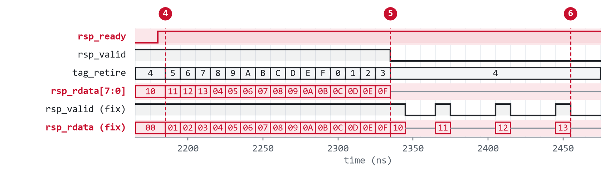

<div align="center">

# Mini DRAM Controller

**행 · 열 명령 버스, 뱅크 그룹, per-bank refresh, RowHammer 대응(RFM)을 갖춘 SystemVerilog DRAM 메모리 컨트롤러**<br>
Spec → RTL → Verification → Performance / PPA

[](rtl/)
[](Makefile)
[](#ppa)
[](LICENSE)

**[📄 포트폴리오 PDF (27쪽)](portfolio-deck/MiniDramController_Portfolio.pdf)** · [PPTX](portfolio-deck/MiniDramController_Portfolio.pptx) · [스펙 문서](docs/spec.md) · [검증 문서](docs/verification.md)

<a href="portfolio-deck/MiniDramController_Portfolio.pdf"></a>

SK hynix HBM Digital Design (RTL Design) 지원 · 권용현

</div>

## 한눈에 보기

| 포화 처리량 (row hit) | 랜덤 회귀 | RowHammer 대응 | 동작 주파수 |
| :---: | :---: | :---: | :---: |
| **80.7%** | **1,200 / 1,200 PASS** | **RAA 한도 위반 0** | **348 MHz** |
| 데이터 버스, 읽기만 · 쓰기만<br>같은 장치의 v3 방식 63.3% (+27%) | 600만 요청 · 패턴 6 · 빌드 16<br>규칙 위반 0 · 기능 bin 32/32 | 뱅크별 ACT 카운터와 RFM<br>한도 도달 131,879회에도 위반 0 | Nangate45 reg2reg 2.831 ns<br>v3 337 MHz · 면적 18,912 µm² |

> [!NOTE]
> 수치는 모두 commit `ab9d522` 기준이다(Verilator 5.052, Yosys 0.52, OpenSTA 3.1). v3 비교값은 commit `1b0943a`, v2는 `c1b8248`, v1은 `2eabd33`을 같은 TB로 돌려 쟀다. v4부터 DRAM 모델에 뱅크 그룹이 생겨, 같은 장치에서의 비교는 v4를 v3 방식으로 빌드한 값(`bus1_refab`)으로 한다. PDF는 2쪽(v0 → v4 요약)과 22–26쪽(v2 – v4)이 이 수치를 쓰고, 3–21쪽의 파형과 수치는 v1(commit `6049e5a`) 기준이다.

## 개요

DRAM 접근 지연은 뱅크 상태에 따라 크게 달라진다. 같은 bank 0에서도 page hit RD는 5사이클, row conflict RD는 11사이클이다. 컨트롤러의 일은 명령 사이의 타이밍 제약을 사이클 단위로 지키면서, 한 요청이 기다리는 동안 다른 뱅크와 다른 요청의 명령을 내보내 그 대기를 가리는 것이다.

이 저장소는 컨트롤러를 다섯 번 설계하고, 각 전환의 득실을 latency, 처리량, 면적과 타이밍으로 수치화했다.

| 버전 | 구조 | 다음 버전으로 넘어간 이유 |
| --- | --- | --- |
| v0 | 요청을 하나씩 처리하는 단일 FSM | 한 번에 요청 하나 |
| v1 | 깊이 4 큐 + 뱅크 엔진 ×4 + 사이클당 명령 1개 arbiter | 뱅크마다 요청 하나, read는 한 번에 하나. REF가 tREFI보다 늦어지고(밀린 REF 최대 549) PREA 없이 REF |
| v2 | 깊이 8 큐 + 명령 단위 FR-FCFS 스케줄러 + RD 4개 파이프라인 | 쓰기가 데이터를 내보낼 때까지 응답하지 않는다. 읽기와 쓰기가 큐 하나를 나눠 쓴다. 주소 매핑이 bank:row:col 하나라 stride 트래픽이 한 뱅크에 몰린다 |
| v3 | 읽기 큐 8 + 쓰기 큐 8, posted write와 포워딩, 쓰기 모아 보내기, page 정책 3종, 주소 매핑 4종 | 명령 버스 하나에 PRE · ACT · RD가 줄을 선다. REF마다 모든 뱅크를 닫는다(약 25사이클). 뱅크 그룹과 RowHammer 대응이 없다 |
| **v4** | 행 · 열 명령 버스 분리, 뱅크 그룹(tCCD · tRRD · tWTR의 S/L), per-bank refresh, RFM | [다음 단계](#다음-단계) |

- **범위**: `host_if` → `mem_ctrl`(`mc_queue` ×2, `mc_xage`, `mc_wdrain`, `mc_sched`, `mc_bank` ×4, `mc_chan`, `mc_refresh`, `mc_resp`) → `dram_model`(뱅크 그룹 2 × 뱅크 2). 단일 클럭 동기 설계, 비동기 리셋
- **타이밍**: 자체 축소 모델(사이클 단위). JEDEC 값이 아니며, 구조와 규칙을 검증하기 위한 값이다
- **범위 밖**: 실제 PHY, multi-rank, ECC, 사인오프 PPA
- **HBM에서의 위치**: 표준 HBM(HBM3E까지)에서 메모리 컨트롤러는 호스트 SoC(GPU · 가속기)에 있다. HBM4 세대부터 base die를 로직 공정으로 만들면서 컨트롤러를 base die로 옮기는 custom HBM 구조가 나왔고, [High-Speed Link Lite](https://github.com/yhkwon-git/High_Speed_Link_Lite)는 이 컨트롤러를 그 구조의 base die에 넣었다

## 주요 특징

| 기능 | 구현 |
| --- | --- |
| 요청 큐 | 읽기 8 + 쓰기 8. RD/WR가 나갈 때까지 머문다. push 때 큐마다 age matrix(`q_older`)를 기록하고, 두 큐 사이의 순서는 `mc_xage`가 둔다. 같은 주소의 쓰기는 들어온 순서대로 나간다(`q_dep`) |
| 쓰기 응답 | posted write: 수락하는 엣지에 응답이 준비된다. 쓰기 큐에 같은 주소가 있는 읽기는 가장 나중 쓰기의 데이터로 바로 응답하고(포워딩) DRAM에 가지 않는다. 읽기 큐에 같은 주소가 있는 쓰기는 그 읽기가 나갈 때까지 호스트 포트에서 기다린다 |
| 쓰기 모아 보내기 | 쓰기가 6개 쌓이면 2개로 줄 때까지, 그리고 읽기가 없을 때 쓰기 우선(`mc_wdrain`). 금지가 아니라 우선순위라서 선택된 큐가 못 쓰는 슬롯은 다른 큐가 쓴다 |
| 스케줄러 | 매 사이클 요청마다 다음 명령(hit → RD/WR, miss → ACT, conflict → PRE)과 준비 여부를 계산한다. 준비된 RD/WR 중 가장 오래된 것, 없으면 ACT/PRE 중 가장 오래된 것(FR-FCFS). 열린 row를 쓸 요청이 남아 있으면 그 뱅크를 닫지 않는다 |
| Page 정책 | open(기본), close(같은 row를 쓸 요청이 없으면 RD/WR에 auto-precharge), timer(16사이클 동안 쓰지 않고 기다리는 요청도 없는 row를 PRE) |
| 주소 매핑 | XOR(기본, `{row, bank ^ row[1:0], col}`), row:bank:col, row:col:bank, bank:row:col(v2) |
| 명령 버스 | 행 버스(ACT · PRE · PREA · REF · REFpb)와 열 버스(RD · WR)가 따로 있어 한 사이클에 둘 다 나간다(HBM 방식). 열 명령이 준비된 뱅크에는 PRE를 보내지 않는다 |
| 뱅크 그룹 | 2 그룹 × 2 뱅크. 같은 그룹 안은 tCCD_L 2 · tRRD_L 3 · tWTR_L 4, 다른 그룹 사이는 tCCD_S 1 · tRRD_S 2 · tWTR_S 2 |
| RowHammer (RFM) | 뱅크마다 ACT 수(RAA)를 세고 refresh마다 4씩 뺀다. 12에 닿은 뱅크는 REFpb를 받을 때까지 ACT를 받지 않는다. 4 이상이고 기다리는 요청이 없는 뱅크에는 미리 REFpb를 준다 |
| 순서와 공정성 | 가장 오래된 요청이 160사이클을 넘게 기다리면 oldest-first로 바뀐다. 그만큼 기다린 쓰기는 쓰기 우선으로 바꾼다 |
| 타이밍 | 뱅크별 tRCD · tRP · tRAS · tRC · tRTP · tWR · tRFCpb(`mc_bank`), 뱅크 그룹별 tCCD · tRRD · tWTR와 채널 tFAW · tRTW · tRFC(`mc_chan`). 카운터가 0이 되면 다음 엣지에 바로 발행한다 |
| 데이터 | RD는 4개까지 버스에 겹쳐 나간다(RL 3). WR 데이터는 WL 1 뒤. busy 신호 없이 모든 규칙을 컨트롤러가 직접 센다 |
| Refresh | per-bank(기본): tREFI/4마다 REFpb 하나를 빚지고 뱅크를 돌아가며 갚는다. 그 뱅크만 PRE → REFpb → tRFCpb(8)로 막고 나머지 뱅크는 계속 일한다. 그 뱅크를 기다리는 요청이 없으면 바로, 4개가 밀리면 즉시 갚는다. all-bank(PREA → REF, v3)도 파라미터로 남겼다 |
| 응답 순서 | 16-entry 응답 버퍼에서 요청 순서대로 반환한다. 동시에 처리 중인 요청은 최대 15개 |
| 파라미터 | `DEPTH`, `FR_FCFS`, `WDRAIN`, `WR_HI` · `WR_LO`, `PAGE_POLICY`, `PAGE_TIMEOUT`, `ADDR_MAP`, `CMD_BUS`, `REF_MODE`, `RFM_EARLY`, `RD_PIPE`, `STARVE_LIMIT`, `REF_URGENT`. 회귀가 기본 빌드와 변형 15개를 함께 돈다 |

## 아키텍처



요청은 수락되면 주소 매핑을 거쳐 방향에 맞는 큐에 들어가고, 그 요청의 RD/WR가 나가는 순간 큐에서 빠진다. ACT와 PRE는 요청을 큐에 둔 채 나간다. 쓰기와 포워딩된 읽기는 수락하는 엣지에 응답 버퍼에 들어가고, DRAM에서 온 읽기 데이터는 4-entry FIFO가 tag를 붙여 넣는다. 호스트에는 요청 순서대로 나간다. DRAM 쪽은 고정 지연(RL, WL)만 약속하는 DFI 형태 인터페이스이고, 명령은 행 버스와 열 버스로 나뉘어 한 사이클에 하나씩 나갈 수 있다. 열 버스에는 row가 없다. 장치는 그 뱅크에 열린 row를 쓴다.

### 한 사이클의 결정

| 요청 상태 | 다음 명령 | 준비 조건 |
| --- | --- | --- |
| hit: 그 row가 열려 있음 | RD / WR | tRCD 경과, 그룹별 tCCD. RD는 그룹별 tWTR과 빈 read 슬롯, WR는 tRTW. 같은 주소의 더 오래된 쓰기가 없을 것 |
| miss: 뱅크가 닫혀 있음 | ACT | tRP · tRC · tRFCpb 경과, 그룹별 tRRD, tFAW, RAA가 12 미만 |
| conflict: 다른 row가 열려 있음 | PRE | tRAS · tRTP · write recovery 경과. 그 row를 쓸 요청이 두 큐에 없을 것 |

준비된 명령 중에서 열 버스와 행 버스에 하나씩 고른다. "가장 오래된 것"은 age matrix에서 AND-OR 한 단으로 나오고, 고른 결과는 one-hot 그대로 큐와 데이터 선택까지 간다.

- **열 버스**: `mc_wdrain`이 고른 큐(읽기, 또는 쓰기 묶음)의 RD/WR, 없으면 다른 큐의 RD/WR
- **행 버스**: ① 준비된 refresh 명령(그 뱅크의 PRE와 REFpb) ② RFM 명령 ③ 고른 큐의 ACT/PRE ④ 다른 큐의 ACT, 또는 아무도 쓰지 않는 row의 PRE(고른 큐가 쓰지 않는 뱅크만) ⑤ timer PRE
- **명령 버스 하나**(`CMD_BUS = 1`, v3 방식): refresh, RFM 다음에 RD/WR를 ACT/PRE보다 먼저(FR-FCFS) 고른다

### 스펙 요약

| 항목 | 값 |
| --- | --- |
| 주소 (14 bit) | 기본 XOR 매핑 `{row[13:6], bank[5:4] ^ row[1:0], col[3:0]}`, 4 bank × 256 row × 16 col × 32 bit (64 KiB). `ADDR_MAP`으로 4종 중 선택 |
| 같은 뱅크 (cycle) | tRCD 3 · tRP 3 · tRAS 6 · tRC 9 · tRTP 2 · tWR 2 (WR → PRE ≥ WL + 1 + tWR = 4) |
| 뱅크 그룹 (cycle, 다른 / 같은 그룹) | tCCD 1 / 2 · tRRD 2 / 3 · tWTR 2 / 4 |
| 채널 (cycle) | tFAW 8 · tRTW 4 · tRFC 12 · tRFCpb 8 · tREFI 64 (per-bank: tREFI/4마다 REFpb) |
| RowHammer | RAA_IMT 4(RFM 시점, refresh마다 이만큼 뺀다) · RAA_MMT 12(이 수에 닿으면 ACT 금지) |
| 데이터 | RD → 데이터 RL = 3, WR → 데이터 WL = 1. 명령 하나가 32 bit 버스트 하나 |
| 명령 | 행 버스: ACT · PRE · PREA · REF · REFpb, 열 버스: RD · WR(auto-precharge 비트 `dram_ap`). 3 bit `dram_cmd_e` |
| 호스트 인터페이스 | `req_*` / `rsp_*` valid/ready. WR는 수락 즉시 응답(`rsp_rdata = 0`), 쓰기 큐에 같은 주소가 있는 RD도 수락 즉시 응답. `rsp_err`는 예약, v4는 0 |

상수는 [`rtl/dram_pkg.sv`](rtl/dram_pkg.sv) 한 곳에서 정의하고, [`docs/spec.md`](docs/spec.md)가 같은 값을 문서로 관리한다.

## 성능 분석

### 경로별 latency

호스트 accept부터 응답 handshake까지의 사이클 수다(`rsp_ready = 1`, directed TB에서 요청 하나씩). v0는 단일 FSM 컨트롤러(`64e73e0`), v1은 `2eabd33`, v2는 `c1b8248`, v3는 `1b0943a`이다.

| 경로 | v0 | v1 | v2 | v3 | v4 | 달라진 점 |
| --- | ---: | ---: | ---: | ---: | ---: | --- |
| Page hit RD | 4 | 6 | 5 | 5 | **5** | |
| Closed-bank RD | 7 | 10 | 8 | 8 | **8** | |
| Row-conflict RD | 11 | 14 | 11 | 11 | **11** | |
| WR (뱅크 상태 무관) | 6–10 | 9–14 | 6–9 | 1 | **1** | v3부터 posted write |
| 쓰기 큐에 있는 주소의 RD | – | – | – | 1 | **1** | v3부터 포워딩 |

같은 directed 순서에서 v3는 all-bank refresh가 끼어든 읽기 하나가 23사이클 걸렸다. v4는 refresh가 그 뱅크만 막아 같은 읽기가 5사이클이다.

### 같은 트래픽에서 v3와 v4

<p align="center"></p>

<sub>랜덤 회귀(패턴마다 seed 50개 × 요청 5,000건, 요청 간격 0–2사이클) 평균. v3는 같은 TB로 commit `1b0943a`에서 잰 값이다([데이터](docs/data/v3_regress_baseline.csv)). 이전 전환은 [v1 → v2](docs/images/regress_v1_v2.png), [v2 → v3](docs/images/regress_v2_v3.png) 그래프에 있다.</sub>

- **conflict가 많은 트래픽이 가장 많이 올랐다**: rand 20.3 → 24.1%(+19%), stride 21.9 → 26.8%(+22%), mixed 21.3 → 24.1%(+13%). 요청마다 필요한 PRE · ACT가 행 버스로 가서 RD/WR와 슬롯을 다투지 않고, refresh가 한 뱅크만 막는다.
- **seq만 3% 낮다**(34.8 → 33.7%). 장치에 뱅크 그룹이 생겨, 같은 그룹 안의 연속 RD/WR는 tCCD_L(2)을 지켜야 한다. XOR 매핑에서는 연속 16 word가 한 뱅크, 한 그룹에 있다. 두 word마다 그룹을 바꾸는 row:col:bank 매핑으로 빌드하면 포화 연속 읽기가 50.0 → 78.5%다(아래 표).
- **뱅크당 refresh 간격이 64보다 조금 짧다**(57–64). RFM이 넣은 REFpb도 refresh로 세기 때문이다. 밀린 refresh는 최대 1개다(v3 4개).

### 포화 처리량: 두 기능을 하나씩

요청을 쉬지 않고 넣으면(요청 간격 0, back-pressure 없음, seed 1, 5,000건) 다음과 같다. 가운데 네 열은 모두 뱅크 그룹이 있는 같은 장치에서 v4를 파라미터로 바꿔 빌드한 값이다.

| 트래픽 | v3 (그룹 없음) | v3 방식 (`bus1_refab`) | 버스 분리만 (`refab`) | per-bank refresh만 (`bus1`) | **v4** | v4 + row:col:bank |
| --- | ---: | ---: | ---: | ---: | ---: | ---: |
| row hit, 읽기만 | 66.7% | 63.3% | 65.6% | 71.8% | **80.7%** | 80.7% |
| row hit, 쓰기만 | 64.3% | 60.4% | 62.1% | 72.3% | **80.7%** | 80.7% |
| row hit, 반반 | 51.4% | 47.3% | 47.8% | 55.2% | **59.6%** | 59.6% |
| 연속 주소, 읽기만 | 58.8% | 39.7% | 40.2% | 48.0% | **50.0%** | **78.5%** |
| 랜덤 주소, 읽기만 | 22.9% | 21.9% | 23.4% | 24.7% | **26.5%** | 27.1% |
| 패턴 혼합, 반반 | 22.2% | 21.7% | 22.7% | 24.3% | **25.7%** | 25.6% |

- **per-bank refresh가 가장 크다**: row hit 읽기 63.3 → 71.8%. all-bank refresh는 tREFI마다 모든 row를 닫고 약 25사이클 동안 아무것도 못 한다. per-bank는 한 뱅크만 tRFCpb(8) 동안 막고, 그 뱅크를 기다리는 요청이 없을 때를 골라 낸다.
- **버스 분리는 per-bank refresh와 함께일 때 크다**: 혼자서는 패턴에 따라 +1–7%, 함께면 71.8 → 80.7%. refresh의 PRE · REFpb와 다른 뱅크의 ACT가 행 버스로 가서 열 버스의 RD 흐름을 끊지 않는다.
- **뱅크 그룹은 매핑을 바꾼다**: 같은 그룹 안 연속 열 명령은 2사이클 간격이라, 한 뱅크에 연속 주소를 모으는 매핑(XOR)은 연속 읽기가 50%에서 막힌다. row:col:bank는 두 word마다 그룹을 바꿔 78.5%다. 대신 16 word stride가 한 뱅크에 몰려 회귀 평균은 XOR보다 낮다(아래 표).
- **랜덤 주소의 상한**: 명령 버스 하나면 요청마다 PRE · ACT · RD 세 슬롯이라 약 33%가 상한이었다. 지금은 tRC(9) · tFAW와 refresh가 상한을 정한다.

### 정책별 비교

랜덤 회귀의 빌드 변형이다. 패턴 6개(변형마다 seed 10개)의 평균이다.

| 빌드 | 바꾼 것 | 데이터 버스 | 읽기 latency | RD↔WR 전환 | row hit |
| --- | --- | ---: | ---: | ---: | ---: |
| 기본 | 두 버스, per-bank refresh, RFM, 쓰기 모아 보내기, open page, XOR | 25.8% | 59.7 | 1,537 | 34.2% |
| `bus1_refab` | 명령 버스 하나 + all-bank refresh (v3 방식) | 23.2% | 67.6 | 1,310 | 34.7% |
| `refab` | all-bank refresh | 24.0% | 65.0 | 1,358 | 34.7% |
| `bus1` | 명령 버스 하나 | 25.0% | 61.8 | 1,480 | 34.3% |
| `rfm_late` | RFM은 한도(12)에 닿았을 때만 | 25.8% | 59.8 | 1,535 | 34.3% |
| `nodrain` | 읽기와 쓰기를 오래된 순으로 (v2 방식) | 25.9% | 60.6 | 1,896 | 34.4% |
| `close` | auto-precharge | **26.0%** | **59.0** | 1,528 | 26.9% |
| `timer` | 16사이클 idle row PRE | 25.9% | 59.3 | 1,519 | 33.2% |
| `map_rbc` | row:bank:col | **26.1%** | 59.2 | 1,535 | 34.3% |
| `map_rcb` | row:col:bank | 24.6% | 64.3 | 1,591 | 41.9% |
| `map_brc` | bank:row:col (v2) | 20.5% | 83.3 | 1,388 | 34.0% |

- **refresh 방식과 버스**: v3 방식(`bus1_refab`)보다 기본 빌드가 11% 높고 읽기 latency가 12% 짧다. 그중 per-bank refresh가 +7–8%(`bus1` 대 `bus1_refab`, 기본 대 `refab`), 버스 분리가 +3%다.
- **RFM**: 미리 주든(기본) 한도에서만 주든(`rfm_late`) 처리량이 같다. 부하가 걸리면 기다리는 요청이 없는 뱅크가 드물어 미리 줄 기회가 거의 없다. RFM 없이 돌린 v4(커밋 전, seed 3 한 번)와 비교하면 hotbank에서 약 5%, rand에서 약 1%가 RowHammer 대응의 비용이다.
- **쓰기 모아 보내기**: 처리량은 같고 방향 전환이 19% 줄며 읽기 latency가 1.5% 짧다. FR-FCFS가 이미 방향별로 묶어 내기 때문이다(tWTR · tRTW 동안 반대 방향 명령이 준비되지 않는다). v3에서 처음에는 반대 큐를 아예 막았다가 처리량이 seed 1에서 최대 12% 떨어져, 우선순위만 바꾸고 빈 슬롯은 반대 큐가 쓰게 했다.
- **close page**: v3에서는 랜덤 · stride에서 5–8% 높았는데 v4에서는 +3%다. auto-precharge의 이점은 PRE 명령 슬롯을 아끼는 것인데, 버스를 나눈 뒤에는 PRE가 RD/WR와 슬롯을 다투지 않는다.
- **timer**: open과 거의 같다. refresh가 tREFI마다 모든 뱅크를 한 번씩 닫아 16사이클 timeout이 걸릴 일이 적다.
- **매핑**: XOR과 row:bank:col은 16 word stride에서 둘 다 뱅크를 돈다. 64 word stride에서는 XOR만 버틴다(아래 분석).

### 트래픽 × 기능 분석

빌드 16개(v4 기본에서 파라미터를 하나씩 바꿈) × 트래픽 7종(64 word stride 포함) × 두 부하(랜덤, 포화)로 1,456회를 돌리고, 같은 파라미터로 면적과 타이밍을 합성했다(`make matrix`, `make ppa-sweep`). 전체 표와 해석은 [분석 문서](docs/analysis.md)에 있다.

<p align="center"></p>

| 질문 | 답 | 근거 |
| --- | --- | --- |
| 가장 큰 손잡이는? | per-bank refresh | all-bank로 바꾸면 포화 평균 −16%, 면적 차이 2% |
| 명령 버스 분리는? | 공짜에 가깝다 | 하나로 바꾸면 포화 −7%, 면적 0.4% 이내 |
| 주소 매핑은? | XOR만 모든 stride에서 버틴다 | 64 word stride: XOR 27.0%, 나머지 8.5–10.0% |
| 큐 8 + 8은? | 처리량 +6%에 면적 +46% | 4 + 4는 읽기 latency 절반, 면적 −31% |
| RD 파이프라이닝은? | 필수 | 1개로 줄이면 포화 −19%, 면적 0.4% |
| FR-FCFS 대 FCFS는? | 이 모델에서는 같다 | FCFS가 면적 +8%(두 큐 사이 나이 필요) |
| 쓰기 모아 보내기는? | 평균은 좋고 꼬리는 나쁘다 | 읽기 평균 −1.7%, p99 +9% |

<sub>fmax는 같은 논리의 세 매핑이 310 MHz, XOR 게이트 두 개가 더 있는 기본 빌드가 348 MHz일 만큼 ABC 잡음(±12%)이 커서, 기능 하나의 타이밍 비용은 이 흐름으로 가려내지 않았다. FF와 면적 차이는 구조에서 나온다.</sub>

### 설계 trade-off

| 선택 | 이점 | 대가 |
| --- | --- | --- |
| 명령 단위 스케줄러 | 요청마다 다음 명령을 바로 낸다. handoff가 없고 같은 row의 hit을 연달아 처리한다 | 매 사이클 16개 엔트리를 평가하는 조합 논리 |
| 행 · 열 명령 버스 | PRE · ACT가 RD/WR와 슬롯을 다투지 않는다. per-bank refresh와 함께 row hit 포화 +27% | DRAM 쪽 명령 핀 두 벌. 같은 뱅크 PRE와 열 명령이 겹치지 않게 막는 논리 |
| per-bank refresh | refresh 동안 다른 뱅크가 계속 일한다. 밀린 refresh 최대 1개 | refresh 명령이 4배 많고, 뱅크를 하나씩 닫는다 |
| RFM (RAA 카운터) | RowHammer 한도를 지킨다. 한도 도달 131,879회에도 위반 0 | FF 20개, hotbank 처리량 약 5%(seed 3) |
| FR-FCFS와 row 보호 | row hit을 먼저 처리해 hit rate와 처리량이 오른다 | 오래된 conflict 요청이 밀릴 수 있어 starvation 보호가 필요하다 |
| 읽기 · 쓰기 큐 분리 | 쓰기가 읽기 자리를 차지하지 않는다. 읽기 큐는 데이터를 저장하지 않는다 | 엔트리 16개, 두 큐 사이 순서(`mc_xage`, `WDRAIN = 0`일 때만 합성됨) |
| posted write + 포워딩 | 쓰기 응답 1사이클. RAW 읽기 37,434건이 DRAM 없이 응답(기본 빌드 회귀) | 같은 주소 읽기가 큐에 있으면 쓰기를 포트에서 잡는다 |
| 쓰기 모아 보내기 | 방향 전환 −19%, 읽기 latency −1.5% | 처리량 이득은 없다(FR-FCFS가 이미 묶는다) |
| XOR 주소 매핑 | v2 매핑보다 stride 3×, 연속 주소 +40% (v4 회귀) | 연속 16 word가 한 뱅크 그룹에 있어 연속 읽기가 tCCD_L에 막힌다 |
| one-hot 선택 | 인덱스로 바꿨다 다시 푸는 단계가 없다(208 → 337 MHz의 일부) | 데이터 선택이 AND-OR 트리 |
| RD 4개 in flight | 연속 읽기 3.4×(v1 대비) | read-return FIFO |
| 16 × 32b 응답 버퍼 | 호스트 계약이 단순하다(in-order) | FF의 34% |

## 검증

모든 시뮬레이션을 bind 체커 두 개가 지켜본다. 체커는 RTL과 TB를 고치지 않고 붙는다. 그 위에서 directed 시나리오 6개와, UVM 구조를 본뜬 랜덤 TB가 돈다. 구조, 규칙 전체, 기능 bin 목록은 [검증 문서](docs/verification.md)에 있다.

| 구성 | 파일 | 하는 일 |
| --- | --- | --- |
| DRAM 타이밍 · 프로토콜 체커 | [`dram_timing_checker.sv`](tb/dram_timing_checker.sv) | `dram_model`의 두 명령 버스만 보고 open row, 명령 시각, 뱅크별 refresh와 RAA를 따로 재구성해 타이밍 18종(뱅크 그룹 S/L, tRFCpb 포함)과 프로토콜 10종(RAA 한도 포함)을 검사한다. auto-precharge는 장치가 precharge하는 엣지를 계산해 다음 ACT의 tRP를 잰다. `mem_ctrl` 내부는 읽지 않는다 |
| 호스트 valid/ready SVA | [`host_if_checker.sv`](tb/host_if_checker.sv) | concurrent assertion 4개(요청 유지, 응답 유지, X/Z, `rsp_err`)와 cover 5개 |
| 랜덤 TB | [`mc_tb_pkg.sv`](tb/mc_tb_pkg.sv) · [`tb_mem_ctrl_rand.sv`](tb/tb_mem_ctrl_rand.sv) | sequence → driver → DUT → monitor → scoreboard(참조 메모리). 주소 매핑을 RTL과 따로 구현하고, 열 버스에 없는 row는 행 버스의 ACT로 따라가며 DRAM 핀의 명령과 요청을 짝짓는다. 기능 bin 32개, seed 재현 |
| Directed TB | [`tb_mem_ctrl.sv`](tb/tb_mem_ctrl.sv) | 시나리오 6개 |

### 쓰기 응답과 포워딩을 어떻게 검사하나

- **posted write**: 응답은 바로 오지만, 핀 모니터가 그 쓰기의 WR가 DRAM에 나가는지 따로 본다. 마지막 응답 뒤 2,000사이클 안에 나가지 않은 쓰기가 남으면 실패다.
- **포워딩**: scoreboard는 수락 엣지의 핀 활동까지 기록한 다음(하강 엣지) 예측한다. 그래서 컨트롤러가 그 엣지에 쓰기 큐에 가지고 있던 쓰기를 정확히 안다. 그런 쓰기가 있는 읽기는 DRAM에 RD가 나가면 실패고, 없는 읽기는 RD 없이 응답하면 실패다. 데이터는 두 경우 모두 참조 메모리와 비교한다.

### 랜덤 회귀: `make regress`

기본 빌드는 트래픽 패턴 6개 × seed 50개 × 요청 5,000건이다. 파라미터 뒤의 코드도 돌도록 변형 빌드 15개를 패턴마다 seed 10개씩 더 돌린다. 모두 1,200회, 600만 요청이다. 빌드와 실행을 코어 수만큼 병렬로 돌려 6코어에서 실행이 약 2분 걸린다.

| 빌드 | 실행 | PASS | 데이터 불일치 | 규칙 위반 | 데이터 버스 | 읽기 latency |
| --- | ---: | ---: | ---: | ---: | ---: | ---: |
| 기본 (두 버스, per-bank refresh, RFM, 쓰기 모아 보내기, open, XOR) | 300 | 300/300 | 0 | 0 | 25.8% | 59.7 |
| `bus1` · `refab` · `bus1_refab` | 180 | 180/180 | 0 | 0 | 25.0 · 24.0 · 23.2% | 61.8 · 65.0 · 67.6 |
| `rfm_late` | 60 | 60/60 | 0 | 0 | 25.8% | 59.8 |
| `fcfs` · `fcfs_nodrain` | 120 | 120/120 | 0 | 0 | 25.8 · 25.9% | 59.8 · 60.7 |
| `starve24` (starvation 한도 24) | 60 | 60/60 | 0 | 0 | 24.7% | 65.1 |
| `rdpipe1` (RD 1개 in flight) | 60 | 60/60 | 0 | 0 | 23.6% | 64.4 |
| `depth4` (읽기 4 + 쓰기 4) | 60 | 60/60 | 0 | 0 | 25.6% | 31.6 |
| `nodrain` | 60 | 60/60 | 0 | 0 | 25.9% | 60.6 |
| `close` · `timer` | 120 | 120/120 | 0 | 0 | 26.0 · 25.9% | 59.0 · 59.3 |
| `map_brc` · `map_rbc` · `map_rcb` | 180 | 180/180 | 0 | 0 | 20.5 · 26.1 · 24.6% | 83.3 · 59.2 · 64.3 |

<sub>데이터 버스와 latency는 패턴별 평균을 다시 평균한 값이다. 기능 bin 32개가 모두 맞았다. 재정렬(뒤에 온 요청의 RD/WR가 먼저 나감)은 3,386,363회, 포워딩은 151,757회, 행 · 열 명령이 한 사이클에 같이 나간 경우는 1,359,346회, RAA가 한도에 닿은 경우는 131,879회였다. 응답 순서와 데이터는 모두 일치했다.</sub>

### Directed 회귀: `make sim`

[`tb/tb_mem_ctrl.sv`](tb/tb_mem_ctrl.sv)의 시나리오 6개가 한 번에 돈다. 아래 중 하나라도 나오면 실패다.

- 데이터 비교가 틀림
- 모델 `access_err`나 `rsp_err`가 한 번이라도 나옴
- 체커가 위반을 잡음

실패한 체크는 모두 `[TB] ERROR`로 찍고 끝까지 진행한다. 끝에 요약을 출력하고 `$fatal`로 0이 아닌 코드를 낸다.

| # | 시나리오 | 확인 내용 |
| --- | --- | --- |
| 1 | Page hit WR → RD | read-back 데이터. 쓰기가 DRAM에 나간 뒤 읽는다 |
| 2 | Page miss (bank 0 row 변경) | PRE → ACT 경로, 새 row와 이전 row의 데이터 |
| 3 | Multi-bank + bank 0 conflict | bank 0의 row가 바뀐 뒤에도 bank 1 데이터 유지 |
| 4 | 4-bank write burst | ACT가 나갔지만 WR는 아직인 뱅크가 동시에 2개 이상(뱅크 병렬), 4개 word read-back |
| 5 | 응답 back-pressure | `rsp_ready`를 150사이클 내린 채 read 20건(tag 16개 초과): 20/20 순서와 데이터 일치, refresh ≥ 1회 |
| 6 | 포워딩 | 같은 주소 쓰기 2건 뒤 읽기: 나중 쓰기의 데이터, DRAM RD 0건. 그 뱅크의 refresh 직후(tRFCpb 동안 ACT가 못 나감)에 시작해 타이밍이 고정된다 |

<details>
<summary>회귀 로그 (commit <code>ab9d522</code>, Verilator 5.052)</summary>

```text
[TB] === SCENARIO 1: page hit WR→RD ===
[TB] hit RD OK (0xa5a55a5a)
[TB] === SCENARIO 2: page miss (bank0 row change) ===
[TB] miss-new RD OK (0xbeef0002)
[TB] miss-old RD OK (0xa5a55a5a)
[TB] === SCENARIO 3: multi-bank + bank0 conflict ===
[TB] bank1 RD OK (0xc0de0001)
[TB] bank0 conflict RD OK (0xd00d0004)
[TB] bank1 survived OK (0xc0de0001)
[TB] === SCENARIO 4: 4-bank write burst (banks opened in parallel) ===
[TB] peak banks opening at once=2
[TB] q bank0 OK (0x10000000)
[TB] q bank1 OK (0x20000000)
[TB] q bank2 OK (0x30000000)
[TB] q bank3 OK (0x40000000)
[TB] === SCENARIO 5: response back-pressure (20 reads, rsp_ready low 150 cycles) ===
[TB] back-pressure OK (20/20 in order, 15 REF during the test)
[TB] === SCENARIO 6: read forwarded from the write queue ===
[TB] forwarded RD OK (0x60000002)
[TB] RD after drain OK (0x60000002)
[TB] access_err count=0 OK
[TB] rsp_err count=0 OK
[TCHK] rule                              spec   min  checked  violations
[TCHK] tRCD   ACT -> RD/WR                  3     3       61           0
[TCHK] tRP    PRE/PREA/AP -> ACT/REF        3     3       53           0
[TCHK] tRAS   ACT -> PRE/PREA               6     6       53           0
[TCHK] tRC    ACT -> ACT, same bank         9     9       50           0
[TCHK] tRTP   RD -> PRE/PREA                2     2       29           0
[TCHK] tWR    WR -> PRE (WL+1+tWR)          4     4       28           0
[TCHK] tRRD_S ACT/REFpb -> ACT/REFpb        2     2       88           0
[TCHK] tRRD_L ACT -> ACT, same group        3     3       50           0
[TCHK] tFAW   4 ACTs per window             8    10       50           0
[TCHK] tCCD_S RD/WR -> RD/WR                1     2       60           0
[TCHK] tCCD_L RD/WR, same group             2     2       59           0
[TCHK] tWTR_S WR -> RD                      2     4       31           0
[TCHK] tWTR_L WR -> RD, same group          4     4       31           0
[TCHK] tRTW   RD -> WR                      4     4       29           0
[TCHK] tRFC   REF -> next command          12     -        0           0
[TCHK] tRFCpb REFpb -> ACT/REFpb, bank      8     8       34           0
[TCHK] RL     RD -> read data              =3     3       31           0
[TCHK] WL     WR -> write data             =1     1       30           0
[TCHK] ACT to an open bank                                           0
[TCHK] RD/WR to a closed bank                                        0
[TCHK] read data with no RD                                          0
[TCHK] RD whose data never came                                      0
[TCHK] write data with no WR                                         0
[TCHK] WR whose data never came                                      0
[TCHK] REF while a row is open                                       0
[TCHK] REFpb to an open bank                                         0
[TCHK] refreshes owed > 8                                            0
[TCHK] ACT at RAA >= 12 (no RFM)                                     0
[TCHK] row bus: ACT 54, PRE 53, PREA 0, REF 0, REFpb 37; column bus: RD 31, WR 30 (0 with auto-precharge); both on one edge 27
[TCHK] refresh interval per bank avg 62.2, max 91 edges (tREFI 64); peak refreshes owed 1
[TCHK] peak RAA 8 (RFM due at 4, limit 12)
[TCHK] PASS: 0 violation(s), 0 waived
[HCHK] PASS: controller violations 0, host violations 0
[TB] PASS — hit/miss/multi-bank/burst/back-pressure/forwarding OK
```

</details>

### 타이밍 규칙 검사

`dram_model`은 상태와 데이터만 모델링하고 명령 간격은 검사하지 않는다. 그래서 명령 핀을 보는 체커를 따로 두었다. 측정 최소가 스펙과 같은 규칙은 컨트롤러가 카운터가 끝나는 엣지에 바로 명령을 낸다는 뜻이다. directed 로그 기준 위반은 0이고, 랜덤 회귀 1,200회에서도 0이다.

| 규칙 | 스펙 | 측정 최소 | 검사한 간격 |
| --- | ---: | ---: | ---: |
| tRCD (ACT → RD/WR) | 3 | 3 | 61 |
| tRP (PRE/PREA/auto-precharge → ACT/refresh) | 3 | 3 | 53 |
| tRAS (ACT → PRE/PREA) | 6 | 6 | 53 |
| tRC (ACT → ACT, 같은 뱅크) | 9 | 9 | 50 |
| tRTP (RD → PRE) | 2 | 2 | 29 |
| tWR (WR → PRE = WL + 1 + tWR) | 4 | 4 | 28 |
| tRRD_S (ACT/REFpb → ACT/REFpb, 다른 뱅크) | 2 | 2 | 88 |
| tRRD_L (ACT → ACT, 같은 그룹) | 3 | 3 | 50 |
| tFAW (ACT 4개 창) | 8 | 10 | 50 |
| tCCD_S (RD/WR → RD/WR) | 1 | 2 | 60 |
| tCCD_L (RD/WR → RD/WR, 같은 그룹) | 2 | 2 | 59 |
| tWTR_S (WR → RD) | 2 | 4 | 31 |
| tWTR_L (WR → RD, 같은 그룹) | 4 | 4 | 31 |
| tRTW (RD → WR) | 4 | 4 | 29 |
| tRFCpb (REFpb → 그 뱅크의 ACT/REFpb) | 8 | 8 | 34 |
| tRFC (REF → 다음 명령) | 12 | – | 0 |
| RL, WL (데이터 지연, 정확히) | 3, 1 | 3, 1 | 31, 30 |

<sub>기본 빌드는 per-bank refresh라 all-bank REF를 쓰지 않는다. tRFC는 `refab` · `bus1_refab` 빌드의 회귀에서 검사된다.</sub>

프로토콜 10종(열린 뱅크에 ACT, 닫힌 뱅크에 RD/WR, RD 없는 읽기 데이터, 오지 않은 읽기 데이터, WR 없는 쓰기 데이터, 오지 않은 쓰기 데이터, 열린 row가 있는 REF, 열린 뱅크에 REFpb, 뱅크당 밀린 refresh 9개 이상, RAA 12 이상인 뱅크에 ACT)도 위반 0이다.

### 코드 커버리지와 남은 구멍

| 범위 | Line | Branch | Toggle |
| --- | ---: | ---: | ---: |
| 컨트롤러 (`mem_ctrl` + `mc_*`) | 94.8% → **98.7%** | 81.8% → **98.2%** | 48.5% → **93.1%** |
| `mc_sched` | 91.9% → **100%** | 62.5% → **96.9%** | 43.2% → **91.5%** |
| `mc_chan` (뱅크 그룹 타이밍) | 100% → **100%** | 96.2% → **100%** | 46.3% → **52.1%** |
| `mc_refresh` | 100% → **100%** | 83.3% → **91.7%** | 89.1% → **94.0%** |
| RTL 전체 (`dram_model` 포함) | 88.9% → **96.0%** | 77.7% → **94.1%** | 53.9% → **93.7%** |

<sub>commit `ab9d522`, `make cov`. 화살표 왼쪽은 directed만, 오른쪽은 랜덤(기본 빌드 18회, 변형 빌드 90회)을 더한 값이다. 결과는 소스 지점 기준으로 합쳤다. FCFS, starvation, close · timer 정책, 다른 주소 매핑, 명령 버스 하나, all-bank refresh의 분기는 변형 빌드에서만 실행된다.</sub>

남은 구멍은 다음과 같다.

- `mc_sched.sv:135–136`: `older()` 함수의 분기 두 개. Verilator가 루프를 펼치면서 상수인 큐 번호로 분기를 접어 카운터가 0으로 남는다(같은 줄의 else 분기는 `nodrain` · `fcfs_nodrain` 빌드에서 434,345회). 두 큐에 걸친 비교는 그 빌드에서 돌았고 결과가 scoreboard와 모두 맞았다
- `mc_refresh.sv:56`: 밀린 refresh 카운터의 포화(15). `REF_URGENT` 4에서 멈추므로 설계상 도달하지 않는다
- `mc_resp.sv:100`: WL이 1보다 클 때 쓰는 쓰기 파이프 단. WL 1에서는 쓰이지 않는다
- `mc_chan`의 toggle(52%): 카운터 상위 비트가 스펙 값보다 넓다(tRFC 11까지 세는 5 bit 폭을 모든 카운터가 쓴다)
- `dram_model`의 오류 경로(닫힌 row 접근, 열린 뱅크에 ACT · REFpb, tRFC · tRFCpb 안의 명령, 짝이 없는 쓰기 데이터). 컨트롤러가 그런 명령을 내지 않았다는 뜻이고, 모델을 직접 모는 negative test가 남았다

## 디버그: 응답 back-pressure에서 태그 wrap-around (v1)

[`docs/coverage.md`](docs/coverage.md)에 gap으로 적어 둔 back-pressure를 실험 TB로 재현하다가 찾은 버그다.

- **증상**: `rsp_ready`를 150사이클 내린 채 read 20건을 보내면, 풀린 뒤 앞의 4건이 엉뚱한 데이터를 돌려주고 뒤의 4건은 응답이 오지 않았다(16/20).
- **원인**: `req_ready`가 큐의 빈 슬롯만 확인했다. 큐는 dispatch로 계속 비므로, 응답이 막혀 있어도 요청을 계속 받았다. 4-bit `tag_alloc`이 16을 돌아 아직 반환되지 않은 tag를 다시 할당했고, 17번째 read가 첫 번째 read의 버퍼 엔트리를 덮어썼다.
- **수정** (`fa08330`): 처리 중인 요청이 15개면 새 요청을 받지 않는다. v2 이후도 같은 규칙을 쓴다(`mc_resp`의 `tag_free`).

```diff
- req_ready = free_found && !ref_due && !ref_active;
+ req_ready = free_found && !ref_due && !ref_active &&
+             (TAG_BITS'(tag_alloc + 1'b1) != tag_retire);
```

- **회귀** (`7e2d4b5`): 시나리오 5로 고정했다. 수정 전 RTL은 첫 응답에서 `0x50000010`(17번째 read의 데이터)을 돌려줘 실패하고, 수정 후에는 20/20이 순서대로 돌아온다. 랜덤 회귀의 "tag 한도에서 요청 대기" bin이 이 상황을 매번 다시 만든다.



<sub>v1, `rsp_ready`가 풀리는 구간. 위 세 줄은 수정 전, 아래 두 줄은 수정 후다. 수정 전에는 tag 4 자리에 17번째 read의 데이터(`10`)가 나가고 16건 뒤 `rsp_valid`가 내려간다. 수정 후에는 `00`부터 `13`까지 20건이 순서대로 나간다.</sub>

같은 재검증에서 나온 나머지 항목은 PDF 20쪽에 정리했다. 병렬성 체크(C)는 `7e2d4b5`에서, handoff +1(B)은 v2에서, out-of-order dispatch와 write-hit 미검증(D)은 랜덤 회귀에서 닫았다. 모델 오류 경로(E)는 남아 있다.

## 디버그: 포워딩 판정이 한 사이클 어긋남 (v3)

- **증상**: 수락 경로를 스케줄러에서 떼어 낸 뒤 첫 랜덤 회귀에서 78회 중 77회가 실패했다. 컨트롤러가 포워딩한 읽기를 scoreboard는 DRAM에 갈 것으로 예측했다. 그 반대 경우도 있었다.
- **원인**: 쓰기의 WR가 나가는 바로 그 엣지에 같은 주소의 읽기가 수락되면, 컨트롤러는 그 쓰기를 아직 큐에 있는 것으로 보고 포워딩한다. 디버그 probe를 bind로 붙여 보니 cycle 265에 수락된 읽기가 정확히 그 경우였다. TB는 이 경우를 "마지막 WR 시각 = 수락 시각"으로 판정하는데, 핀 모니터가 그 시각을 class 핸들(`vif.cyc`)로 읽었다. 같은 엣지에서 갱신되는 카운터를 class 안에서 읽으면 갱신 전 값이라는 보장이 없다.
- **수정**: TB top이 모듈에서 직접 읽은 엣지 번호(`hif.cyc`)를 핀 모니터에 인자로 넘긴다.
- **결과**: 960회 모두 통과. RTL은 바꾸지 않았다.

## PPA

`make ppa`: sv2v → Yosys 0.52 → Nangate45 typical(OpenSTA 예제 라이브러리) → OpenSTA 3.1([`syn/ppa.sh`](syn/ppa.sh)). `mem_ctrl` 단독이고 배선과 클럭 트리는 포함하지 않는다. 절대값보다 버전 사이의 상대 비교에 쓰는 수치다.

| | v0 단일 FSM | v1 (`fa08330`) | v2 (`c1b8248`) | v3 첫 구현 (커밋 전) | v3 (`1b0943a`) | **v4** (`ab9d522`) |
| --- | ---: | ---: | ---: | ---: | ---: | ---: |
| Area (µm²) | 1,208 | 9,692 | 13,478 | 19,263 | 18,600 | **18,912** |
| Cell | 559 | 4,433 | 6,781 | 10,991 | 9,924 | **9,995** |
| FF | 131 | 1,072 | 1,344 | 1,582 | 1,582 | **1,616** |
| reg2reg (ns) | 0.809 | 2.880 | 2.753 | 4.765 | 2.922 | **2.831** |
| ≈ fmax (MHz) | 1,182 | 343 | 357 | 208 | 337 | **348** |

v4는 기능이 늘었는데도 v3보다 빠르다. 명령 버스가 하나일 때는 RD/WR와 ACT/PRE 중 하나를 고르는 단계(`use_col`, FCFS면 나이 비교까지)가 critical path에 있었다. 두 버스에서는 그 단계가 필요 없다. RFM을 넣기 전에는 2.612 ns(377 MHz, 커밋 전 측정)였고, 뱅크별 RAA 카운터와 RFM 명령 선택이 행 버스 앞에 붙어 2.831 ns가 됐다.

### v3 첫 구현의 타이밍 문제

- **증상**: 기능을 다 넣은 첫 v3는 reg2reg 4.765 ns(208 MHz)였다. critical path는 쓰기 모드 레지스터 → 후보 선택 → 큐 pop → 같은 주소 비교 → 포워딩 · `req_ready` → push enable이었고, fanout 58 · 104인 넷 두 개가 2 ns를 차지했다.
- **수정 1, 수락 경로 분리**: 같은 주소 비교(`match`)가 이번 엣지에 나가는 엔트리를 빼느라 스케줄러 결정을 기다렸다. 나가는 엔트리도 그대로 비교하게 바꿨다. 그 엔트리에서 포워딩해도 데이터는 같고, 그 엔트리 때문에 쓰기를 한 사이클 더 잡아도 문제가 없다.
- **수정 2, 후보 집합 합치기**: RD/WR 후보와 ACT/PRE 후보를 "선택된 큐의 것, 없으면 다른 큐의 것" 한 집합씩으로 묶어, 가장 오래된 것 고르기를 5번에서 3번으로 줄였다. pop 때 같은 주소 의존 비트를 지우던 논리는 `q_valid`가 이미 가리고 있어서 뺐다. 3.745 ns(264 MHz).
- **수정 3, one-hot 유지**: 고른 엔트리를 인덱스로 바꿨다가 큐 pop, tag 선택, 쓰기 데이터 선택에서 다시 푸는 단계가 fanout 72인 넷을 만들었다. one-hot 그대로 AND-OR로 고르게 바꿨다. 2.922 ns(337 MHz).
- **결과**: v2(357 MHz)와 6% 차이 안쪽이고, 면적은 +38%다. 쓰기 큐 데이터와 큐 두 개의 age matrix가 늘었다. `WDRAIN = 1` 기본 빌드에서는 두 큐 사이 age matrix(`mc_xage`)와 bank idle 카운터가 쓰이지 않아 합성에서 빠진다. 같은 논리라도 넷리스트가 조금 바뀌면 ABC 결과가 몇 % 흔들리므로(v2에서 확인한 잡음), 위 표는 모두 해당 커밋을 `make ppa`로 다시 돌린 값이다.

<details>
<summary>FF 구성 (v4, 1,616 FF)</summary>

| 블록 | FF | 주요 레지스터 |
| --- | ---: | --- |
| 쓰기 큐 (`mc_queue`) | 560 | `q_wdata` 256, `q_wait` 64, `q_row` 64, `q_dep` 64, `q_older` 56, `q_col` 32, 기타 24 |
| 응답 측 (`mc_resp`) | 555 | 응답 데이터 512, done 16, read FIFO 23, tag 4 |
| 읽기 큐 (`mc_queue`) | 276 | `q_wait` 64, `q_row` 64, `q_older` 56, `q_tag` 32, `q_col` 32, 기타 28 |
| 뱅크 ×4 (`mc_bank`) | 104 | open row 32, 타이밍 카운터 48, RAA 20, open 4 |
| 채널 (`mc_chan`) | 75 | 카운터 55(그룹별 tCCD_L · tRRD_L · tWTR_L 30 포함), tFAW 창 20 |
| 쓰기 데이터 파이프 · refresh · 모드 | 46 | 쓰기 데이터 33, refresh 11(`refi` 4, `owed` 4, 다음 뱅크 2, hold 1), 모드 2 |

`q_older`의 대각선(자기 자신보다 오래됨)은 상수 0이라 합성에서 빠져 큐마다 56이다.

데이터를 담는 플롭(응답 512, 쓰기 데이터 256 + 32)이 전체 FF의 50%다. 응답 버퍼를 메모리로 바꾸거나 in-flight 한도와 함께 줄이는 것이 면적을 줄이는 가장 큰 손잡이다.

</details>

## 실행 방법

**Verilator 5.x**(`--binary`, `--timing`)와 `make`가 필요하다. Ubuntu 22.04의 apt 패키지는 Verilator 4.x이므로 Ubuntu 24.04 이상을 쓰거나 소스에서 빌드한다.

```bash
git clone https://github.com/yhkwon-git/mini-dram-controller.git
cd mini-dram-controller
make check-tools     # verilator, python3, cocotb 확인
make sim             # directed 시나리오 6개 + bind 체커 → [TB] PASS
make sim-rand        # 랜덤 1회 (PATTERN=mixed SEED=1 N=2000)
make regress         # 랜덤 회귀: 패턴 6 × SEEDS × N, 변형 빌드 15개 포함
make cov             # line / branch / toggle 커버리지, directed + 랜덤
make ppa             # 면적과 타이밍 (sv2v, Yosys, OpenSTA, Nangate45 필요)
make matrix          # 빌드 16 × 트래픽 7 × 두 부하, docs/analysis.md의 표와 heatmap
make ppa-sweep       # 빌드마다 같은 파라미터로 면적과 타이밍
make sim WAVES=1     # tb_mem_ctrl.vcd도 기록
make lint            # Verilator lint-only -Wall: 경고 0, waiver는 이유와 함께 syn/lint.vlt
```

- **Windows**: WSL에 Verilator를 설치하고 저장소 폴더에서 `wsl make sim`
- **병렬**: `make regress`와 `make cov`는 빌드와 실행을 `JOBS`(기본: 코어 수)개씩 돌린다. `JOBS=1`이면 하나씩
- **그래프**: `python tools/regress_report.py build/regress/regress.csv --plots docs/images --baseline docs/data/v3_regress_baseline.csv --baseline-label "v3 (1b0943a)" --label v4 --compare-name regress_v3_v4.png` (matplotlib 필요)
- **PPA 도구 경로**: `SV2V`, `LIB` 환경 변수로 sv2v 실행 파일과 Nangate45 라이브러리를 지정한다
- **cocotb (선택, ≥ 2.0)**: `pip install cocotb && make sim-cocotb`. 리셋 직후 idle 상태만 보는 smoke test다
- 실패한 랜덤 실행은 `build/regress/<빌드>_<패턴>_seed<번호>.log`에 로그가 남고, 같은 `+PATTERN` · `+SEED`로 그대로 재현된다
- 빌드 결과는 `obj_dir*/`, `build/`에 생기며 git에서 제외된다
- 컨트롤러 RTL(`rtl/dram_pkg.sv`, `mem_ctrl.sv`, `mc_*.sv`)은 ModelSim-Altera 10.1d에서도 컴파일된다. 그 버전이 읽지 못하는 폭이 파라미터인 캐스트(`BANK_BITS'(b)` 등)는 쓰지 않는다

## 저장소 구조

```text
rtl/
  dram_pkg.sv                  파라미터, 뱅크 그룹, 타이밍, 명령 enum, page 정책, refresh 방식, RFM 한도, 주소 매핑 함수
  host_if.sv                   호스트 valid/ready (조합 pass-through)
  mem_ctrl.sv                  아래 블록 연결, 주소 매핑, req_ready, 포워딩
  mc_queue.sv                  요청 큐 (읽기용 · 쓰기용), age matrix, 같은 주소 비교와 의존
  mc_xage.sv                   두 큐 사이의 age
  mc_wdrain.sv                 읽기 모드 / 쓰기 묶음 (watermark)
  mc_sched.sv                  다음 명령 계산, 열 · 행 버스 선택, auto-precharge 판단, timer PRE, refresh · RFM 명령
  mc_bank.sv                   뱅크별 open row, 타이밍 카운터, auto-precharge, tRFCpb, idle 시간, RAA
  mc_chan.sv                   뱅크 그룹별 타이밍 카운터, tFAW 창, tRFC
  mc_refresh.sv                밀린 refresh, 다음 refresh 뱅크, refresh hold
  mc_resp.sv                   tag, read FIFO, 쓰기 파이프, 응답 버퍼
  dram_model.sv                뱅크 그룹, open row, 메모리, 두 명령 버스, 읽기 / 쓰기 파이프 (TB용 행동 모델)
  mem_ctrl_top.sv              host_if + mem_ctrl + dram_model
tb/
  tb_mem_ctrl.sv               directed 시나리오 6개 (make sim)
  tb_mem_ctrl_rand.sv          랜덤 TB top, DRAM 핀 모니터 (make sim-rand, make regress)
  mc_tb_pkg.sv                 sequence · driver · responder · monitor · scoreboard · coverage · env, TB 쪽 주소 매핑
  mc_host_if.sv                호스트 포트 interface
  dram_timing_checker.sv       DRAM 타이밍 · 프로토콜 체커 (bind)
  host_if_checker.sv           호스트 valid/ready SVA (bind)
  mc_bind.sv                   두 체커를 RTL에 bind
  run_regress.sh               빌드 × 패턴 × seed 회귀 병렬 실행
  test_mem_ctrl.py             cocotb smoke test
  cocotb_runner.py             cocotb 빌드와 실행 (make sim-cocotb)
syn/
  ppa.sh, sta.tcl              면적과 타이밍 (make ppa)
tools/
  regress_report.py            회귀 CSV 요약 표, --plots로 그래프
  plot_regress.py              패턴별 기준선, 버전 비교 그래프
  matrix_report.py             트래픽 × 빌드 표, heatmap, 빌드별 면적 · 타이밍
  cov_summary.py               커버리지 병합, 모듈별 표, --holes
docs/
  spec.md                      주소 맵, 타이밍, 명령, 인터페이스, 스케줄러, 쓰기 묶음, page 정책, refresh
  verification.md              검증 구조, 체커 규칙, 회귀 · 커버리지 결과
  scheduler-throughput.md      버전별 latency, 처리량, 정책 비교, trade-off
  analysis.md                  트래픽 × 기능 매트릭스, 성능 대 면적 · 타이밍, 권장 설정
  coverage.md                  시나리오별 확인 항목, 닫힌 구멍과 남은 구멍
  data/                        버전 비교 그래프의 기준값 (v1, v2, v3)
  images/                      README 그래프와 파형
portfolio-deck/                포트폴리오 PDF, PPTX (v0 → v4 요약, v1 상세, v2 – v4)
Makefile                       sim, sim-rand, regress, cov, ppa, lint, sim-cocotb, clean
```

## 문서

| 문서 | 내용 |
| --- | --- |
| [스펙](docs/spec.md) | 주소 맵, 뱅크 그룹 타이밍, 명령 집합과 두 버스, DRAM · 호스트 인터페이스, 스케줄러, 쓰기 묶음, page 정책, refresh, RFM, 파라미터 |
| [검증](docs/verification.md) | bind 체커 규칙, 랜덤 TB 구조, 트래픽 패턴, 회귀 · 기능 커버리지 · 코드 커버리지 결과 |
| [스케줄러 latency · throughput](docs/scheduler-throughput.md) | v0 – v4 경로별 latency, 처리량, 두 버스 · refresh 방식 · 정책 · 매핑 비교, trade-off |
| [분석](docs/analysis.md) | 트래픽 7종 × 빌드 16개 × 두 부하, refresh · 버스 · 매핑 · 큐 깊이 · 정책별 성능과 면적 · 타이밍, 권장 설정 |
| [커버리지](docs/coverage.md) | 시나리오별 확인 항목, 랜덤 회귀로 닫힌 구멍, 남은 구멍 |
| [포트폴리오 PDF](portfolio-deck/MiniDramController_Portfolio.pdf) | 27쪽. v0 → v4 요약(2쪽), v1의 아키텍처 · RTL · 파형 · 디버그 · PPA(3–21쪽), v2 – v4의 구조 · 검증 · 성능 · 트래픽 분석 · PPA(22–26쪽) |

## 다음 단계

- [ ] 뱅크 그룹을 word 단위로 섞으면서 XOR 해싱을 유지하는 매핑 (연속 주소와 stride를 함께)
- [ ] 배치 · 배선이 있는 흐름(OpenROAD)으로 기능별 타이밍 비용 다시 재기
- [ ] 응답 버퍼(FF의 34%) 축소, `dram_model` 오류 경로 negative test
- [x] 트래픽 × 정책 매트릭스(64 word stride 포함)와 기능별 면적 · 타이밍 trade-off 표 ([분석](docs/analysis.md))
- [x] 행 · 열 명령 버스 분리, 뱅크 그룹(tCCD · tRRD · tWTR의 S/L), per-bank refresh, RFM (v4)
- [x] 읽기 · 쓰기 큐 분리, posted write와 포워딩, 쓰기 모아 보내기 (v3)
- [x] page 정책 3종(open · close · timer), 주소 매핑 4종(XOR · row:bank:col · row:col:bank · bank:row:col) (v3)
- [x] tREFI 기준 refresh와 PREA (REF 간격 평균 = tREFI, v1 88–135) (v2)
- [x] `dram_busy` 제거, tRTP · tRRD · tFAW · tCCD · tWTR · tRTW · WL 추가 (v2)
- [x] wait → issue handoff 제거, RD 파이프라이닝 (연속 읽기 3.4×) (v2)
- [x] 명령 간격 모니터를 bind 체커로, non-blocking 랜덤 호스트로 out-of-order dispatch와 write-hit 검증 (v1 → v2)

## 관련 프로젝트

[High-Speed Link Lite](https://github.com/yhkwon-git/High_Speed_Link_Lite): 컨트롤러를 base die에 두는 custom HBM 구조를 전제로 한 HBM base die 디지털 1채널 슬라이스. 이 저장소의 v4 컨트롤러 RTL(`44a0bb3`)을 파일 그대로 가져가, DFI 형태 인터페이스로 디지털 PHY(행 · 열 CA 핀, 1.6 GHz beat와 WDQS, RDQS 캡처) · DFT와 묶었다. 컨트롤러가 DRAM 쪽에 고정 지연(RL, WL)만 약속하므로 PHY 앞에 그대로 붙는다.
