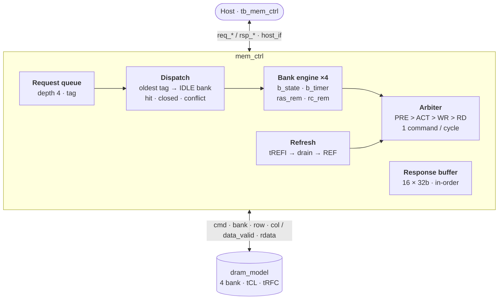
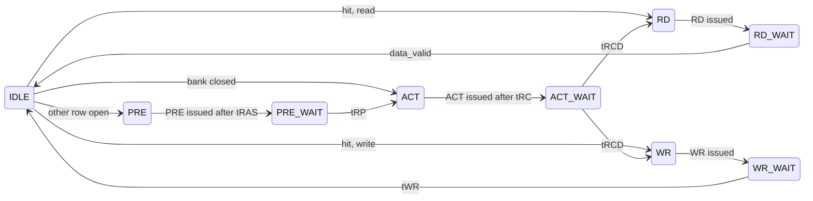

<div align="center">

# Mini DRAM Controller

**요청 큐와 뱅크 병렬 스케줄러를 갖춘 SystemVerilog DRAM 메모리 컨트롤러**<br>
Spec → RTL → Verification → Performance / PPA

[](rtl/)
[](Makefile)
[](#ppa)
[](LICENSE)

**[📄 포트폴리오 PDF (21쪽)](portfolio-deck/MiniDramController_Portfolio.pdf)** · [PPTX](portfolio-deck/MiniDramController_Portfolio.pptx) · [스펙 문서](docs/spec.md) · [검증 문서](docs/verification.md)

<a href="portfolio-deck/MiniDramController_Portfolio.pdf"></a>

SK hynix HBM Digital Design (RTL Design) 지원 · 권용현

</div>

## 한눈에 보기

| 4-bank burst | 랜덤 회귀 | DRAM 규칙 위반 | 코드 커버리지 |
| :---: | :---: | :---: | :---: |
| **17 cycles (2.06×)** | **300 / 300 PASS** | **0** | **Line 97.1%**<br>**Toggle 95.9%** |
| 단일 FSM(v0)은 35 cycles | 150만 요청 · 패턴 6종<br>directed 5 / 5 PASS | 타이밍 7종 · 프로토콜 5종<br>refresh 2종은 알려진 gap | `mem_ctrl`, directed + 랜덤<br>Branch 94.4% |

> [!NOTE]
> 회귀, 타이밍 규칙, 커버리지, latency 수치는 commit `2eabd33` 기준이다(Verilator 5.052). RTL은 `47ec4ea` 이후 바뀌지 않았다. PPA 수치와 PDF의 파형은 commit `6049e5a`를 다시 실행해 측정했고, 그 뒤 `fa08330`(태그 wrap-around 수정)과 `7e2d4b5`(회귀 TB 보강)가 PDF 19쪽의 항목 A, C를 반영했다. PDF의 커버리지 수치는 랜덤 회귀를 넣기 전 값이다.

## 개요

DRAM 접근 지연은 뱅크 상태에 따라 크게 달라진다. 같은 bank 0에서도 page hit RD는 6사이클, row conflict RD는 14사이클이다. 컨트롤러의 일은 명령 사이의 타이밍 제약을 사이클 단위로 지키면서, 한 뱅크가 기다리는 동안 다른 뱅크의 명령을 내보내 그 대기를 가리는 것이다.

이 저장소는 요청을 하나씩 처리하던 단일 FSM 컨트롤러(v0)를 **깊이 4 요청 큐 + 뱅크 엔진 ×4 + 사이클당 명령 1개 arbiter**(v1)로 바꾸고, 그 전환의 득실을 latency, throughput, 면적으로 수치화한 프로젝트다.

- **범위**: `host_if` → `mem_ctrl` → `dram_model`. 단일 클럭 동기 설계, 비동기 리셋
- **타이밍**: 자체 축소 모델(사이클 단위). JEDEC 값이 아니며, 구조와 규칙을 검증하기 위한 값이다
- **범위 밖**: 실제 PHY, multi-rank, ECC, 사인오프 PPA

## 주요 특징

| 기능 | 구현 |
| --- | --- |
| 요청 큐 | 깊이 4. 대상 뱅크가 IDLE인 엔트리 중 가장 오래된 tag부터 dispatch. 나이는 `q_tag − tag_retire`로 비교해 tag가 한 바퀴 돌아도 순서가 유지된다 |
| 뱅크 엔진 ×4 | 뱅크마다 `b_state`, `b_timer`. tRCD, tRP, tWR는 타이머가, tRAS, tRC는 `ras_rem`, `rc_rem`이 막는다 |
| 명령 arbiter | 사이클당 DRAM 명령 1개. 우선순위는 PRE > ACT > WR > RD, 같은 종류 안에서는 `rr_ptr`부터 round-robin |
| Page 정책 | Open-page. 같은 row면 ACT 없이 RD/WR, 다른 row가 열려 있으면 PRE → ACT, 닫혀 있으면 ACT |
| Refresh | Drain-then-REF. `tREFI`가 지나면 새 요청을 막고, 진행 중인 요청을 끝낸 뒤 REF |
| 응답 순서 | 16-entry 응답 버퍼에서 `tag_retire` 순서로 in-order 반환. 동시에 처리 중인 요청은 최대 15개 |
| Shadow open-row | 컨트롤러가 `bank_open`, `bank_row`를 직접 관리한다. 모델의 `page_hit`은 관측용이다 |

## 아키텍처



`mem_ctrl_top`이 `host_if`, `mem_ctrl`, `dram_model`을 연결한다. `host_if`는 지금 조합 pass-through이고, `dram_model`은 TB용 행동 모델이다.

### 뱅크 엔진 상태

dispatch 시점의 page 판정에 따라 세 경로로 나뉜다. 대기 상태는 타이머가 0이 되는 사이클에 상태만 바꾸고, 다음 명령은 그다음 사이클에 arbiter를 거쳐 나간다. 그래서 실측 ACT → RD/WR, PRE → ACT 간격은 `tRCD + 1`, `tRP + 1`이며 스펙보다 짧아지지 않는다.



### 스펙 요약

| 항목 | 값 |
| --- | --- |
| 주소 (14 bit) | `{bank[13:12], row[11:4], col[3:0]}`, 4 bank × 256 row × 16 col × 32 bit (64 KiB) |
| 타이밍 (cycle) | tRCD 3 · tRP 3 · tRAS 6 · tRC 9 · tCL 2 · tWR 2 · tRFC 12 · tREFI 64 |
| 명령 | NOP · ACT · RD · WR · PRE · REF (3 bit `dram_cmd_e`) |
| 호스트 인터페이스 | `req_*` / `rsp_*` valid/ready. WR도 응답한다(`rsp_rdata = 0`). `rsp_err`는 예약, v1은 0 |

상수는 [`rtl/dram_pkg.sv`](rtl/dram_pkg.sv) 한 곳에서 정의하고, [`docs/spec.md`](docs/spec.md)가 같은 값을 문서로 관리한다.

## 성능 분석

### 경로별 latency

호스트 accept부터 응답 handshake까지의 사이클 수다(`rsp_ready = 1`). v0는 같은 TB로 측정한 단일 FSM 컨트롤러(`64e73e0`)이고, v1 값은 현재 HEAD에서 다시 확인했다.

| 경로 | v0 | v1 | v1에서 늘어난 이유 |
| --- | ---: | ---: | --- |
| Page hit RD | 4 | 6 | 큐 단계 +1, 응답 버퍼 +1 |
| Closed-bank RD | 7 | 10 | 위에 더해 wait → issue handoff +1 |
| Closed-bank WR | 6 | 9–12 | 같음. 폭은 다른 뱅크와의 중재 때문 |
| Row-conflict RD | 11 | 14 | `PRE_WAIT`, `ACT_WAIT` 뒤 handoff가 각각 +1 |
| Row-conflict WR | 10 | 13–14 | 같음 |

### Throughput

| 지표 | v0 | v1 |
| --- | ---: | ---: |
| 4-bank write 4건, 첫 accept → 마지막 응답 | 35 cycles | **17 cycles (2.06×)** |
| 같은 사이클에 바쁜 뱅크 엔진 수 | 1 | 최대 4 |
| 연속 RD | — | 4사이클당 최대 1회 (read pipe 1개) |
| Refresh로 새 요청이 막힌 비율 | — | 23.3% (`make sim` 834사이클 중 194, REF 10회) |

Burst 구간에서는 8사이클 동안 매 사이클 명령이 나간다. 뱅크가 4개일 때 병목은 뱅크 타이밍이 아니라 사이클당 하나뿐인 명령 슬롯이다. 반대로 단독 요청은 큐와 응답 버퍼 단계 때문에 v0보다 2–3사이클 느리다.

REF 하나는 `tRFC + 2` = 14사이클과 그 앞의 drain 동안 요청을 막는다. drain이 없다면 14 / (64 + 14) ≈ 18%다. 시나리오 5에서는 응답이 막힌 read가 read pipe 하나로 4사이클마다 나가서 drain 한 번이 26사이클까지 길어지고, 그래서 실측이 더 높다.


<sub>TB 시나리오 4, commit `6049e5a`의 Verilator VCD. ① b0 accept. b1–b3가 2사이클 간격으로 들어오고 곧바로 dispatch된다. ② b0와 b2가 동시에 ACT를 기다리면 `rr_ptr`에 따라 b2가 먼저 나간다. 이 구간에서는 매 사이클 명령이 나간다. ③ 닫혀 있던 b2의 WR가 PRE가 필요한 b0, b1보다 먼저 끝난다. ④ 응답은 tag 순서(b0 → b1 → b2 → b3)로 4사이클 연속 나가고, 먼저 끝난 b2는 버퍼에서 기다린다.</sub>

### 설계 trade-off

| 선택 | 이점 | 대가 |
| --- | --- | --- |
| Open-page (auto-PRE 없음) | Hit 재사용, 뱅크별 지역성 | Row conflict마다 PRE + ACT |
| Drain-then-REF | 단순하고 예측 가능 | Latency 버블. `refi_cnt`를 REF가 끝난 뒤 다시 장전해 REF 간격이 tREFI + drain + tRFC로 늘어난다. REF 전에 PREA를 내지 않고 모델이 열린 row를 닫는다 |
| 깊이 4 큐 + 뱅크 엔진 | 뱅크별 대기를 가리고 다중 outstanding 요청을 받는다 | 단독 요청 +2–3 cycles. 명령 슬롯 1개, read pipe 1개 |
| Tag 기반 in-order 응답 | 호스트 계약이 단순하다 | 먼저 끝난 응답이 16 × 32b 버퍼에서 기다린다(FF의 약 절반) |
| Shadow open-row | 모델을 들여다보지 않고 스케줄한다 | `dram_model`과 상태를 맞춰야 한다 |

## 검증

모든 시뮬레이션을 bind 체커 두 개가 지켜본다. 체커는 RTL과 TB를 고치지 않고 붙는다. 그 위에서 directed 시나리오 5개와, UVM 구조를 본뜬 랜덤 TB가 돈다. 구조, 규칙 전체, 기능 bin 목록은 [검증 문서](docs/verification.md)에 있다.

| 구성 | 파일 | 하는 일 |
| --- | --- | --- |
| DRAM 타이밍 · 프로토콜 체커 | [`dram_timing_checker.sv`](tb/dram_timing_checker.sv) | `dram_model`의 명령 핀만 보고 open row와 명령 시각을 따로 재구성해 타이밍 7종과 프로토콜 5종을 검사한다. `mem_ctrl` 내부는 읽지 않는다 |
| 호스트 valid/ready SVA | [`host_if_checker.sv`](tb/host_if_checker.sv) | concurrent assertion 4개(요청 유지, 응답 유지, X/Z, `rsp_err`)와 cover 5개 |
| 랜덤 TB | [`mc_tb_pkg.sv`](tb/mc_tb_pkg.sv) · [`tb_mem_ctrl_rand.sv`](tb/tb_mem_ctrl_rand.sv) | sequence → driver → DUT → monitor → scoreboard(참조 메모리). back-pressure responder, 기능 bin 17개, seed 재현 |
| Directed TB | [`tb_mem_ctrl.sv`](tb/tb_mem_ctrl.sv) | 시나리오 5개 |

### 랜덤 회귀: `make regress`

트래픽 패턴 6개 × seed 50개 × 요청 5,000건으로 모두 300회, 150만 요청이다(commit `2eabd33`, 약 70초).

| 항목 | 결과 |
| --- | --- |
| PASS | **300 / 300** |
| 데이터 불일치 · 타이밍 위반 · 프로토콜 위반 | **0 · 0 · 0** |
| 기능 bin | **17 / 17** |
| 재정렬 (뒤에 온 요청의 RD/WR가 먼저 나감) | 332,014회. 응답 순서와 데이터는 모두 일치 |

<p align="center"></p>

| 패턴 | row hit | 데이터 버스 사용률 | latency 평균 / p99 | REF 간격 평균 | 최대 refresh debt |
| --- | ---: | ---: | ---: | ---: | ---: |
| seq | 65.0% | 12.3% | 36.0 / 76.3 | 109.1 | 271 |
| rowhit | 84.4% | 29.1% | 31.6 / 85.0 | 87.9 | 76 |
| mixed | 14.9% | 13.8% | 43.1 / 86.9 | 120.2 | 281 |
| rand | 3.1% | 17.4% | 42.4 / 88.9 | 113.7 | 202 |
| hotbank | 1.8% | 8.7% | 50.2 / 90.7 | 133.6 | 478 |
| stride | 0.9% | 7.5% | 51.9 / 90.8 | 135.0 | 549 |

<sub>seed 50개 평균이고, 최대 refresh debt만 최댓값이다. latency는 요청 수락에서 응답까지의 사이클 수, 데이터 버스 사용률은 RD 데이터나 WR 데이터가 오간 사이클의 비율이다. 패턴 정의는 [검증 문서](docs/verification.md#트래픽-패턴)에 있다.</sub>

랜덤 회귀가 드러낸 것은 세 가지다.

- **Refresh가 밀린다.**
  - 부하가 걸리면 REF 간격이 tREFI(64)의 1.4–2.1배가 되고, 아직 내지 못한 REF가 최대 549개까지 쌓인다.
  - directed 시나리오에서는 평균 84사이클, debt 3이라 이 규모가 보이지 않았다.
  - 원인은 두 가지다. drain-then-REF는 큐가 빌 때까지 REF를 미룬다. 또 `refi_cnt`는 REF가 끝난 뒤에야 다시 장전된다.
  - 실제 DRAM이라면 retention 위반이다. 체커가 이를 따로 세고(waived) [다음 단계](#다음-단계)의 첫 항목으로 올렸다.
- **데이터 버스가 비어 있다.**
  - 사용률이 7.5–29.1%에 그친다.
  - 사이클당 명령 1개와 read in-flight 1개가 상한을 정한다.
  - 이 값이 읽기 파이프라이닝과 행/열 명령 버스 분리의 기준선이다.
- **row hit는 트래픽이 정한다.** open-page의 이득은 지역성이 있는 `seq` · `rowhit`에서만 나온다.

### Directed 회귀: `make sim`

[`tb/tb_mem_ctrl.sv`](tb/tb_mem_ctrl.sv)의 시나리오 5개가 한 번에 돈다. 아래 중 하나라도 나오면 실패다.

- 데이터 비교가 틀림
- 모델 `access_err`나 `rsp_err`가 한 번이라도 나옴
- 체커가 위반을 잡음

실패한 체크는 모두 `[TB] ERROR`로 찍고 끝까지 진행한다. 끝에 요약을 출력하고 `$fatal`로 0이 아닌 코드를 낸다.

| # | 시나리오 | 확인 내용 |
| --- | --- | --- |
| 1 | Page hit WR → RD | read-back 데이터 |
| 2 | Page miss (bank 0 row 변경) | PRE → ACT 경로, 새 row와 이전 row의 데이터 |
| 3 | Multi-bank + bank 0 conflict | bank 0의 row가 바뀐 뒤에도 bank 1 데이터 유지 |
| 4 | 4-bank write burst | 같은 사이클에 바쁜 뱅크 엔진 ≥ 2 (관측 4), 4개 word read-back |
| 5 | 응답 back-pressure | `rsp_ready`를 150사이클 내린 채 read 20건(tag 16개 초과): 20/20 순서와 데이터 일치, REF ≥ 1회 |

<details>
<summary>회귀 로그 (commit <code>2eabd33</code>, Verilator 5.052)</summary>

```text
[TB] === SCENARIO 1: page hit WR→RD ===
[TB] hit RD OK (0xa5a55a5a)
[TB] === SCENARIO 2: page miss (bank0 row change) ===
[TB] miss-new RD OK (0xbeef0002)
[TB] miss-old RD OK (0xa5a55a5a)
[TB] === SCENARIO 3: multi-bank + bank0 conflict ===
[TB] bank1 RD OK (0xc0de0001)
[TB] bank0 conflict RD OK (0xd00d0004)
[TB] bank1 survived OK (0xc0de0001)
[TB] === SCENARIO 4: 4-bank write burst (bank engines in parallel) ===
[TB] peak bank engines active at once=4
[TB] q bank0 OK (0x10000000)
[TB] q bank1 OK (0x20000000)
[TB] q bank2 OK (0x30000000)
[TB] q bank3 OK (0x40000000)
[TB] === SCENARIO 5: response back-pressure (20 reads, rsp_ready low 150 cycles) ===
[TB] back-pressure OK (20/20 in order, 3 REF during the test)
[TB] access_err count=0 OK
[TB] rsp_err count=0 OK
[TCHK] rule                          spec   min  checked  violations
[TCHK] tRCD  ACT -> RD/WR               3     4       58           0
[TCHK] tRP   PRE -> ACT/REF             3     4       24           0
[TCHK] tRAS  ACT -> PRE                 6    10       24           0
[TCHK] tRC   ACT -> ACT                 9    14       50           0
[TCHK] tWR   WR -> PRE                  2    14       11           0
[TCHK] tRFC  REF -> next command       12    16        9           0
[TCHK] tCL   RD -> data (exact)         3     3       30           0
[TCHK] ACT to an open bank                                       0
[TCHK] RD/WR to a closed bank                                    0
[TCHK] RD/WR to a row not open                                   0
[TCHK] data_valid with no RD                                     0
[TCHK] RD whose data never came                                  0
[TCHK] REF while a row is open                                  30  waived (known v1 gap)
[TCHK] refresh debt > 8 tREFI                                    0
[TCHK] commands: ACT 54, RD 30, WR 28, PRE 24, REF 10
[TCHK] REF interval avg 84.0, max 104 edges (tREFI 64); peak refresh debt 3
[TCHK] PASS: 0 violation(s), 30 waived
[HCHK] PASS: controller violations 0, host violations 0
[TB] PASS — hit/miss/multi-bank/burst/back-pressure OK
```

</details>

### 타이밍 규칙 검사

`dram_model`은 상태와 데이터만 모델링하고 명령 간격은 검사하지 않는다. 그래서 명령 핀을 보는 체커를 따로 두었다. 아래는 `make sim`(리셋 후 834사이클)의 결과이고, 랜덤 회귀 300회에서도 위반은 0이다. 간격은 두 이벤트를 샘플한 클럭 엣지 사이의 사이클 수다.

| 규칙 | 스펙 | 측정 최소 | 검사한 간격 | 위반 |
| --- | ---: | ---: | ---: | ---: |
| tRCD (ACT → RD/WR) | 3 | 4 | 58 | 0 |
| tRP (PRE → ACT/REF) | 3 | 4 | 24 | 0 |
| tRAS (ACT → PRE) | 6 | 10 | 24 | 0 |
| tRC (ACT → ACT) | 9 | 14 | 50 | 0 |
| tWR (WR → PRE) | 2 | 14 | 11 | 0 |
| tRFC (REF → 다음 명령) | 12 | 16 | 9 | 0 |
| tCL (RD → `data_valid`) | 2 | 3 | 30 | 0 |

측정 최소가 스펙보다 1 긴 규칙이 셋 있다.
- tRCD, tRP: 위의 wait → issue handoff 때문이다.
- tCL: 모델이 RD를 받은 엣지에서 tCL 엣지 뒤에 `data_valid`를 레지스터로 올리고, 그 값이 다음 엣지에 샘플되기 때문이다. 그래서 체커는 tCL을 "정확히 tCL + 1"로 검사한다.

프로토콜 5종(열린 뱅크에 ACT, 닫힌 뱅크나 다른 row에 RD/WR, RD 없는 `data_valid`, 데이터가 오지 않은 RD)도 위반 0이다. REF 때 열린 row는 directed에서 30건 나온다. 알려진 문제라 waived로 따로 센다.

### 코드 커버리지와 남은 구멍

| 모듈 | Line | Branch | Toggle |
| --- | ---: | ---: | ---: |
| `mem_ctrl` | 94.1% → **97.1%** | 91.7% → **94.4%** | 61.8% → **95.9%** |
| `dram_model` | 100.0% → **100.0%** | 83.3% → **83.3%** | 83.3% → **99.0%** |
| RTL 전체 | 95.7% → **97.9%** | 90.0% → **92.2%** | 71.0% → **97.1%** |

<sub>commit `2eabd33`, `make cov`. 화살표 왼쪽은 directed만, 오른쪽은 랜덤 18회(패턴 6 × seed 3 × 5,000건)를 더한 값이다. 두 TB의 결과를 소스 지점 기준으로 합쳤다.</sub>

남은 구멍은 다음과 같다.

- `mem_ctrl.sv:318`의 PRE_WAIT → IDLE. v1은 다른 row를 열 때만 PRE를 내므로 쓰이지 않는 경로다. close-page 정책을 넣으면 쓰인다
- `mem_ctrl.sv:290` · `298` · `302`는 파라미터 상수 조건이고, `310`은 `case` default라 구조상 도달하지 않는다
- `dram_model`의 오류 경로 3곳(닫힌 row 읽기, 열린 뱅크에 다른 row ACT, 닫힌 row에 WR). 컨트롤러가 그런 명령을 내지 않았다는 뜻이고, 모델을 직접 모는 negative test가 남았다

이전에 남겼던 out-of-order dispatch, write-hit 경로, 타이밍 assertion, random traffic 구멍은 랜덤 회귀로 닫았다([커버리지 노트](docs/coverage.md)).

## 디버그: 응답 back-pressure에서 태그 wrap-around

[`docs/coverage.md`](docs/coverage.md)에 gap으로 적어 둔 back-pressure를 실험 TB로 재현하다가 찾은 버그다.

- **증상**: `rsp_ready`를 150사이클 내린 채 read 20건을 보내면, 풀린 뒤 앞의 4건이 엉뚱한 데이터를 돌려주고 뒤의 4건은 응답이 오지 않았다(16/20).
- **원인**: `req_ready`가 큐의 빈 슬롯만 확인했다. 큐는 dispatch로 계속 비므로, 응답이 막혀 있어도 요청을 계속 받았다. 4-bit `tag_alloc`이 16을 돌아 아직 반환되지 않은 tag를 다시 할당했고, 17번째 read가 첫 번째 read의 버퍼 엔트리를 덮어썼다.
- **수정** (`fa08330`): 처리 중인 요청이 15개면 새 요청을 받지 않는다.

```diff
- req_ready = free_found && !ref_due && !ref_active;
+ req_ready = free_found && !ref_due && !ref_active &&
+             (TAG_BITS'(tag_alloc + 1'b1) != tag_retire);
```

- **회귀** (`7e2d4b5`): 시나리오 5로 고정했다. 수정 전 RTL은 첫 응답에서 `0x50000010`(17번째 read의 데이터)을 돌려줘 실패하고, 수정 후에는 20/20이 순서대로 돌아온다.


<sub>`rsp_ready`가 풀리는 구간. 위 세 줄은 수정 전, 아래 두 줄은 수정 후다. 수정 전에는 tag 4 자리에 17번째 read의 데이터(`10`)가 나가고 16건 뒤 `rsp_valid`가 내려간다. 수정 후에는 `00`부터 `13`까지 20건이 순서대로 나간다.</sub>

같은 재검증에서 나온 나머지 항목은 PDF 19쪽에 정리했다. 병렬성 체크의 근거가 약했던 항목 C는 `7e2d4b5`에서 고쳤다. "open bank ≥ 2" 대신 동시에 바쁜 뱅크 엔진 수로 판정한다. Handoff +1(B), out-of-order dispatch와 write-hit 미검증(D), 모델 체커 경로 미검증(E)은 다음 단계에 남아 있다.

## PPA

sv2v → Yosys 0.52 → Nangate45 typical (OpenSTA 예제 라이브러리) → OpenSTA 3.1. `mem_ctrl` 단독이고 배선과 클럭 트리는 포함하지 않는다. 절대값보다 버전 사이의 상대 비교에 쓰는 수치다.

| | v0 단일 FSM | v1 (`6049e5a`) | v1 + tag 수정 (`fa08330`) |
| --- | ---: | ---: | ---: |
| Area (µm²) | 1,208 | 9,819 | 9,692 |
| Cell | 559 | 4,414 | 4,433 |
| FF | 131 | 1,072 | 1,072 |
| reg2reg (ns) | 0.809 | 2.642 | 2.880 |
| ≈ fmax (MHz) | 1,182 | 373 | 343 |

- **면적의 58%가 플롭이다.** 응답 버퍼 하나가 528 FF(전체 면적의 29%)이고, 데이터를 담는 플롭 768개가 전체 FF의 72%다.
- **Critical path** (v1, 29 levels, 2.642 ns): `tag_retire` → `q_tag − tag_retire` 나이 비교 → 슬롯 선택 → page 판정 → `b_state`. fanout 46인 NOR4 한 단이 0.866 ns(33%)를 차지한다.
- **줄일 수 있는 곳** (추정, 미측정): 데이터 플롭은 리셋이 필요 없다(약 −613 µm²). `b_timer`는 8 bit에서 2 bit로 충분하다(−24 FF). `b_wdata` 128 FF는 `q_wdata`의 복사본이라 슬롯 인덱스를 넘기면 없앨 수 있다.

<details>
<summary>FF 구성 (v1, 1,072 FF)</summary>

| 블록 | FF | FF 면적 (µm²) | 주요 레지스터 |
| --- | ---: | ---: | --- |
| 응답 버퍼 | 528 | 2,809 | `rsp_data` 512, `rsp_done` 16 |
| 뱅크 엔진 ×4 | 248 | 1,319 | `b_wdata` 128, `b_addr` 48, `b_timer` 32, `b_state` 16 |
| 요청 큐 ×4 | 211 | 1,123 | `q_wdata` 128, `q_addr` 56, `q_tag` 16, `q_valid` 4 |
| Shadow open-row | 64 | 340 | `bank_row` 32, `rc_rem` 16, `ras_rem` 12, `bank_open` 4 |
| 기타 | 21 | 112 | `refi_cnt` 7, `tag_alloc` 4, `tag_retire` 4, `rd_bank_q` 2 |

</details>

## 실행 방법

**Verilator 5.x**(`--binary`, `--timing`)와 `make`가 필요하다. Ubuntu 22.04의 apt 패키지는 Verilator 4.x이므로 Ubuntu 24.04 이상을 쓰거나 소스에서 빌드한다.

```bash
git clone https://github.com/yhkwon-git/mini-dram-controller.git
cd mini-dram-controller
make check-tools     # verilator, python3, cocotb 확인
make sim             # directed 시나리오 5개 + bind 체커 → [TB] PASS
make sim-rand        # 랜덤 1회 (PATTERN=mixed SEED=1 N=2000)
make regress         # 랜덤 회귀: 패턴 6 × SEEDS × N (기본 20 × 2,000)
make cov             # line / branch / toggle 커버리지, directed + 랜덤
make sim WAVES=1     # tb_mem_ctrl.vcd도 기록
make lint            # Verilator lint-only
```

- **Windows**: WSL에 Verilator를 설치하고 저장소 폴더에서 `wsl make sim`
- **cocotb (선택, ≥ 2.0)**: `pip install cocotb && make sim-cocotb`. 리셋 직후 idle 상태만 보는 smoke test다
- **그래프**: `python tools/regress_report.py build/regress/regress.csv --plots docs/images` (matplotlib 필요)
- 실패한 랜덤 실행은 `build/regress/<패턴>_seed<번호>.log`에 로그가 남고, 같은 `+PATTERN` · `+SEED`로 그대로 재현된다
- 빌드 결과는 `obj_dir*/`, `build/`에 생기며 git에서 제외된다

## 저장소 구조

```text
rtl/
  dram_pkg.sv                  파라미터, 명령 enum, 주소 헬퍼
  host_if.sv                   호스트 valid/ready (조합 pass-through)
  mem_ctrl.sv                  큐, dispatch, 뱅크 엔진 ×4, arbiter, refresh, 응답 버퍼
  dram_model.sv                뱅크, open row, tCL, tRFC, access_err (TB용 행동 모델)
  mem_ctrl_top.sv              세 블록 연결
tb/
  tb_mem_ctrl.sv               directed 시나리오 5개 (make sim)
  tb_mem_ctrl_rand.sv          랜덤 TB top, DRAM 핀 모니터 (make sim-rand, make regress)
  mc_tb_pkg.sv                 sequence · driver · responder · monitor · scoreboard · coverage · env
  mc_host_if.sv                호스트 포트 interface
  dram_timing_checker.sv       DRAM 타이밍 · 프로토콜 체커 (bind)
  host_if_checker.sv           호스트 valid/ready SVA (bind)
  mc_bind.sv                   두 체커를 RTL에 bind
  run_regress.sh               패턴 × seed 회귀 실행
  test_mem_ctrl.py             cocotb smoke test
  cocotb_runner.py             cocotb 빌드와 실행 (make sim-cocotb)
tools/
  regress_report.py            회귀 CSV 요약 표, --plots로 그래프
  plot_regress.py              패턴별 기준선 그래프
  cov_summary.py               커버리지 병합, 모듈별 표, --holes
docs/
  spec.md                      주소 맵, 타이밍, 명령, 호스트 IF, 스케줄러, refresh
  verification.md              검증 구조, 체커 규칙, 회귀 · 커버리지 결과
  scheduler-throughput.md      latency, throughput, trade-off
  coverage.md                  시나리오별 확인 항목, 닫힌 구멍과 남은 구멍
  images/                      README 파형과 그래프
portfolio-deck/                포트폴리오 PDF, PPTX
Makefile                       sim, sim-rand, regress, cov, lint, sim-cocotb, clean
```

## 문서

| 문서 | 내용 |
| --- | --- |
| [스펙](docs/spec.md) | 주소 맵, 타이밍 파라미터, 명령 집합, 호스트 인터페이스 규칙, 스케줄러와 refresh 정책, 구현 상태 |
| [검증](docs/verification.md) | bind 체커 규칙, 랜덤 TB 구조, 트래픽 패턴, 회귀 · 기능 커버리지 · 코드 커버리지 결과 |
| [스케줄러 latency · throughput](docs/scheduler-throughput.md) | 경로별 latency (v0 대비), burst throughput, refresh 비용, trade-off, 다음 개선점 |
| [커버리지](docs/coverage.md) | 시나리오별 확인 항목, 랜덤 회귀로 닫힌 구멍, 남은 구멍 |
| [포트폴리오 PDF](portfolio-deck/MiniDramController_Portfolio.pdf) | 아키텍처 비교, RTL 구현, 파형, 디버그, PPA를 21쪽으로 정리 |

## 다음 단계

- [ ] tREFI 카운터를 REF와 무관하게 돌리고 postpone 한도를 둬서 평균 REF 간격을 tREFI로 맞추기. REF 전에 PREA 발행 (랜덤 회귀에서 refresh debt 최대 549)
- [ ] `dram_busy` 입력 대신 컨트롤러가 tRFC를 직접 세기 (실제 DRAM에는 busy 신호가 없다)
- [ ] 읽기 파이프라이닝과 행/열 명령 버스 분리로 데이터 버스 사용률(현재 7.5–29.1%) 올리기
- [ ] tCCD · tRRD · tFAW · tWTR를 스펙과 체커에 추가
- [ ] 대기 상태가 끝나는 사이클에 바로 명령 발행 (handoff −1 cycle)
- [ ] `dram_model` 오류 경로(`access_err`) negative test, 네 뱅크가 모두 바쁠 때 REF가 걸리는 경우를 bin으로 확인
- [ ] 응답 버퍼와 `b_timer`를 줄인 뒤 면적 재측정
- [x] 명령 간격 모니터를 bind 체커로 저장소에 넣기 ([`tb/dram_timing_checker.sv`](tb/dram_timing_checker.sv))
- [x] non-blocking 랜덤 호스트로 out-of-order dispatch와 write-hit 경로 검증 (재정렬 332,014회, write-hit 212,161회)

## 관련 프로젝트

[High-Speed Link Lite](https://github.com/yhkwon-git/High_Speed_Link_Lite): HBM base die 디지털 링크 1채널 슬라이스. 그 프로젝트의 메모리 컨트롤러는 큐 head만 발행하는 in-order 구조이고, 이 저장소는 그다음 단계인 뱅크 병렬 처리, tag 기반 응답 재정렬, refresh 스케줄링을 구현했다.

## License

MIT. [LICENSE](LICENSE)를 본다.
