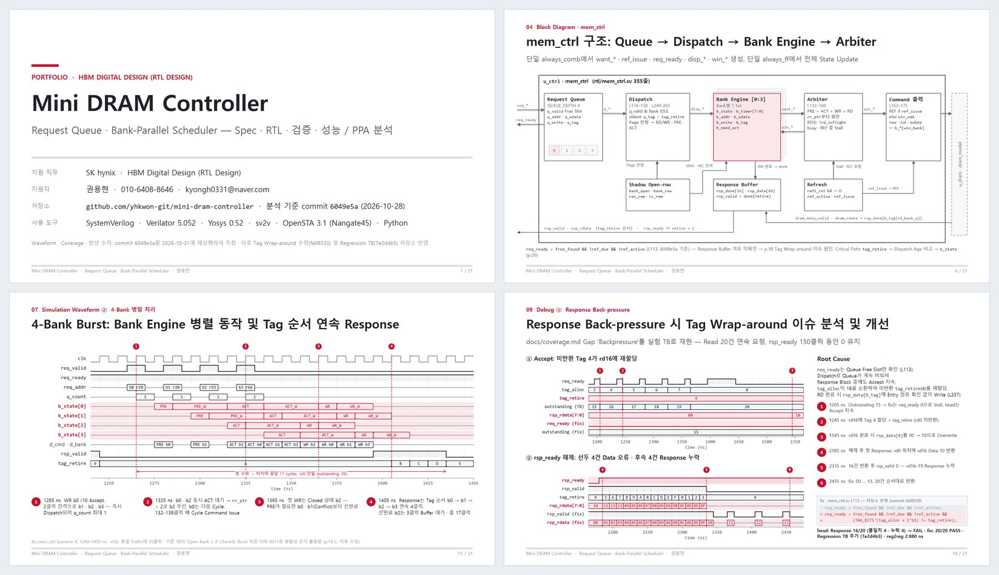

# Mini DRAM Controller

SystemVerilog로 설계한 DRAM 메모리 컨트롤러 — **Request Queue + Bank-Parallel Scheduler**, 자체 Timing 모델 기반 Spec · RTL · 검증 · 성능/PPA 분석

> **포트폴리오 PDF (21쪽): [MiniDramController_Portfolio.pdf](portfolio-deck/MiniDramController_Portfolio.pdf)**  
> SK hynix · HBM Digital Design (RTL Design) 지원 · **권용현** · 010-6408-8646 · kyongh0331@naver.com

[](portfolio-deck/MiniDramController_Portfolio.pdf)

| 항목 | 결과 |
|------|------|
| 4-Bank Write Burst | 첫 Accept → 마지막 Response **35 → 17클럭 (2.06×)**, v0 단일 FSM 대비 |
| Timing Rule 7종 (VCD Checker) | tRCD · tRP · tRAS · tRC · tWR · tCL · tRFC **Violation 0** |
| Coverage (Verilator, `mem_ctrl`) | Line 94.3% · Branch 91.9% |
| Debug | Response Back-pressure 시 4-bit Tag Wrap-around 재현 → 수정 + Regression TB |
| PPA (Nangate45 typical, 참고값) | Area 9,819 µm² · reg2reg 2.642 ns (≈373 MHz) |

PDF가 브라우저에서 열리지 않으면 [다운로드](https://github.com/yhkwon-git/mini-dram-controller/raw/main/portfolio-deck/MiniDramController_Portfolio.pdf) · 원본 [PPTX](portfolio-deck/MiniDramController_Portfolio.pptx)

<sub>덱의 측정값과 코드 줄 번호는 commit `6049e5a` 기준입니다. 이후 Tag Wrap-around 수정(`fa08330`), Back-pressure Regression TB(`7e2d4b5`), 문서 갱신(`d3061ca`)을 반영했습니다.</sub>

---

## Overview / 구성

Host (`host_if`) → **depth-4 request queue** → **bank engine ×4** + command arbiter → `dram_model`

- Open-page policy (page hit / closed / row conflict), drain-then-REF refresh
- One DRAM command per cycle; per-bank timers (tRCD / tRP / tRAS / tRC / tWR) run in parallel
- In-order responses through a 16-entry tag buffer (at most 15 requests in flight)
- Directed SystemVerilog TB (`make sim`, 5 scenarios) + optional cocotb smoke test

```
rtl/             dram_pkg, host_if, dram_model, mem_ctrl, mem_ctrl_top
tb/              tb_mem_ctrl.sv, test_mem_ctrl.py, cocotb_runner.py
docs/            spec.md, scheduler-throughput.md, coverage.md
portfolio-deck/  MiniDramController_Portfolio.pdf / .pptx
Makefile         sim / lint / sim-cocotb
```

- Spec: [docs/spec.md](docs/spec.md)
- Latency / throughput: [docs/scheduler-throughput.md](docs/scheduler-throughput.md)
- Coverage and gaps: [docs/coverage.md](docs/coverage.md)

---

## Build & simulate / 빌드 · 시뮬레이션

Requires **Verilator 5.x** (`--binary`, `--timing`) and `make`. Ubuntu 22.04's apt package is Verilator 4.x — use Ubuntu 24.04+ or build Verilator from source.

```bash
git clone https://github.com/yhkwon-git/mini-dram-controller.git
cd mini-dram-controller
make check-tools
make sim             # 5 directed scenarios -> [TB] PASS
make sim WAVES=1     # also writes tb_mem_ctrl.vcd
make lint
```

Optional cocotb (>= 2.0): `pip install cocotb && make sim-cocotb`

Windows: install Verilator in WSL, then run `wsl make sim` from the repository folder.  
Build output goes to `obj_dir/` (gitignored).

---

## Roadmap / 로드맵

| Horizon | Focus |
|---------|--------|
| **Done** | Spec, queue + bank-parallel scheduler, hit/miss/multi-bank/burst/back-pressure TB, tag wrap-around fix, throughput + coverage notes, portfolio deck |
| **Next** | REF-under-load regression, issue on the wait-exit cycle (−1 handoff), non-blocking host + random traffic, timing assertions and negative tests for the model |

## License

MIT — see [LICENSE](LICENSE).
