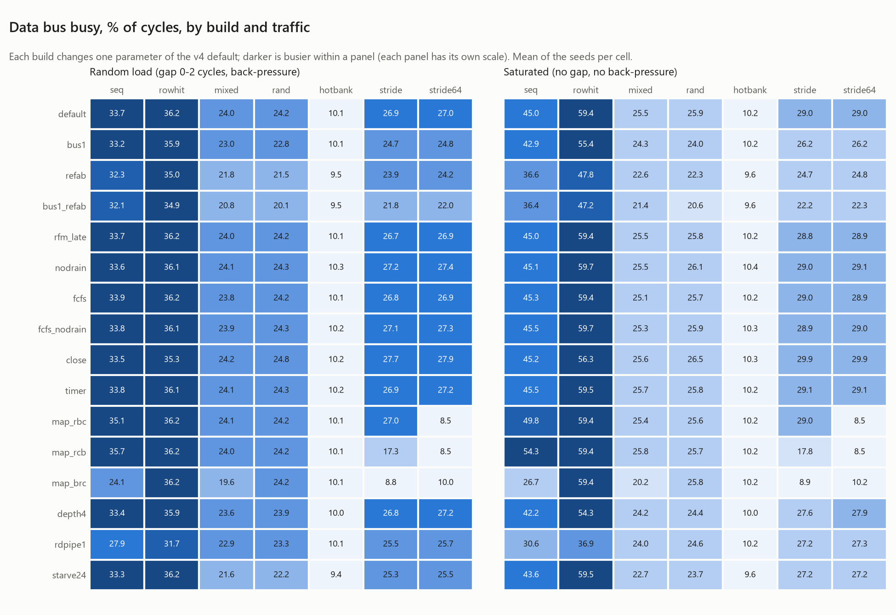

# 정책 분석: 트래픽 × 기능, 성능 대 비용

v4 컨트롤러의 기능과 정책이 어떤 트래픽에서 얼마나 득이 되고, 면적과 타이밍으로 얼마를 치르는지 정리한다. 수치는 모두 RTL commit `ab9d522`, 매트릭스 TB와 스크립트 commit `322632f` 기준이다(Verilator 5.052, Yosys 0.52, OpenSTA 3.1, Nangate45 typical). 타이밍은 자체 축소 모델이라(docs/spec.md), 절대값보다 빌드 사이의 차이를 본다.

## 방법

| 항목 | 내용 |
| --- | --- |
| 빌드 | v4 기본 빌드 하나와, 파라미터를 하나씩 바꾼 변형 15개 (`make regress`와 같은 목록) |
| 트래픽 | 회귀의 6패턴에 `stride64`(64 word 간격 = 모든 뱅크의 한 row씩 건너뜀)를 더한 7패턴. 읽기 50%, 같은 주소 재사용 20% |
| 부하 | **랜덤 부하**: 요청 간격 0–2사이클, 응답 back-pressure(`make regress`와 같음), seed 10개. **포화**: 요청 간격 0, back-pressure 없음, seed 3개 |
| 지표 | 데이터 버스 사용률(처리량), 읽기 latency 평균, 전체 latency p99, row hit rate |
| 면적 · 타이밍 | 같은 파라미터로 `mem_ctrl`을 합성(`make ppa-sweep`: Yosys `chparam` → Nangate45 → OpenSTA) |
| 실행 | `make matrix N=5000`(1,456회, 모두 PASS, 규칙 위반 0, 데이터 불일치 0), `make ppa-sweep`, `python3 tools/matrix_report.py` |

**타이밍 잡음.** ABC는 타이밍 목표 없이 매핑하므로 넷리스트가 조금만 달라져도 결과가 흔들린다. 세 주소 매핑(bank:row:col, row:bank:col, row:col:bank)은 비트 배선만 다른 같은 논리라 세 빌드의 결과가 완전히 같았고(310 MHz), XOR 게이트 두 개가 더 있는 기본 빌드는 348 MHz였다. 타이밍 목표를 준 매핑(`abc -D 2000`)도 같은 넷리스트를 냈다. 그래서 아래 표의 fmax 차이는 ±12% 안쪽이면 구조 차이로 보지 않는다. FF 수는 정확하고, 면적은 ±2–3% 안에서 믿을 만하다.

## 한눈에 보기

| 질문 | 답 | 근거 (포화 평균, 랜덤 부하 평균) |
| --- | --- | --- |
| 가장 큰 손잡이는? | **per-bank refresh** | all-bank로 바꾸면 32.0 → 26.9%(−16%), 26.0 → 24.0% |
| 명령 버스 분리는? | 득. 면적 비용은 없다 | 하나로 바꾸면 32.0 → 29.9%(−7%), 면적 차이 0.4% 이내 |
| 주소 매핑은? | **XOR만 모든 stride에서 버틴다** | 64 word stride: XOR 27.0%, 나머지 8.5–10.0% |
| 큐 깊이 8 + 8은? | 처리량 +6%에 면적 +46% | 4 + 4: 포화 30.1%, 읽기 latency 31.7(8 + 8은 57.8) |
| RD 파이프라이닝은? | 필수 | RD 1개로 줄이면 포화 32.0 → 25.8%(−19%), row hit −38% |
| FR-FCFS 대 FCFS는? | 이 트래픽에서는 같다 | 26.0 대 26.0%. FCFS가 오히려 면적 +8% |
| 쓰기 모아 보내기는? | 평균은 좋고 꼬리는 나쁘다 | 처리량 같음, 읽기 평균 −1.7%, p99 +9%(hotbank +25%) |
| page 정책은? | open이 기본으로 맞다 | close는 저지역성 +3%, row hit −5%. timer는 차이 없음 |
| RFM은? | 필요하고, 미리 줄 필요는 없다 | 미리 주기 끔 = 성능 같음, 면적 −0.8% |

## 1. Refresh: all-bank 대 per-bank

| 빌드 | 포화 seq | 포화 rowhit | 포화 평균 | 부하 평균 | 읽기 latency (부하) | p99 (부하) |
| --- | ---: | ---: | ---: | ---: | ---: | ---: |
| 기본 (per-bank, 두 버스) | 45.0% | 59.4% | **32.0%** | **26.0%** | **57.8** | **126** |
| `refab` (all-bank, 두 버스) | 36.6% | 47.8% | 26.9% | 24.0% | 63.4 | 132 |
| `bus1` (per-bank, 버스 하나) | 42.9% | 55.4% | 29.9% | 24.9% | 60.4 | 128 |
| `bus1_refab` (all-bank, 버스 하나 = v3 방식) | 36.4% | 47.2% | 25.7% | 23.0% | 66.4 | 135 |

- **all-bank refresh는 tREFI마다 채널 전체를 멈춘다.** PREA로 열린 row를 모두 닫고 tRP, REF, tRFC(12)를 기다린 뒤 다시 연다. 한 번에 약 25사이클, tREFI(64)의 1/3 남짓이다. row hit 트래픽은 모든 row를 다시 열어야 해서 손해가 가장 크다(포화 rowhit 47.8%).
- **per-bank refresh는 한 뱅크만 tRFCpb(8) 동안 막고, 그 뱅크를 기다리는 요청이 없을 때를 고른다.** 다른 세 뱅크는 계속 일한다. 포화 평균 +19%, rowhit +24%다.
- **두 기능은 서로 키운다.** 버스 분리만으로는 +5%(25.7 → 26.9%), per-bank refresh만으로는 +16%(25.7 → 29.9%), 함께면 +25%(→ 32.0%)다. per-bank refresh의 PRE · REFpb가 행 버스로 가서 다른 뱅크의 RD 흐름을 끊지 않기 때문이다.
- **비용**: per-bank는 면적 +2%(refresh 대상 뱅크 포인터, 뱅크별 hold 논리), FF는 같다. refresh 명령이 4배 많아지는 것은 명령 버스가 둘이라 문제가 되지 않는다.

## 2. 명령 버스: 하나 대 둘

- 버스가 하나면 랜덤 주소 요청은 PRE · ACT · RD 세 슬롯을 차지한다. 데이터 한 비트에 명령 세 개라 약 33%가 상한이었다(v3 포화 랜덤 읽기 22.9%).
- 둘이면 PRE · ACT는 행 버스로 가고 RD/WR는 열 버스로 간다. 포화 기준 평균 +7%, 랜덤 부하 기준 rand +6%, stride +9%, 읽기 latency −4%다.
- 같은 뱅크에 PRE와 열 명령이 같은 엣지에 나가지 않도록, 열 명령이 준비된 뱅크에는 PRE를 보내지 않는다(FCFS일 때 실제로 필요한 보호).
- 면적은 차이가 없다(0.4% 이내). 버스가 하나일 때 FF가 16개 많은데, 열 · 행 선택 중 하나를 고르는 나이 비교가 큐의 age matrix 대각선 비트까지 읽어 합성에서 지우지 못하기 때문이다.

## 3. 주소 매핑과 stride, 뱅크 그룹

| 매핑 | seq (부하 / 포화) | stride 16 | stride 64 | rand | 부하 평균 |
| --- | ---: | ---: | ---: | ---: | ---: |
| XOR `{row, bank ^ row[1:0], col}` (기본) | 33.7 / 45.0 | 26.9 | **27.0** | 24.2 | **26.0** |
| row:bank:col | 35.1 / 49.8 | 27.0 | 8.5 | 24.2 | 23.6 |
| row:col:bank | 35.7 / **54.3** | 17.3 | 8.5 | 24.2 | 22.3 |
| bank:row:col (v2) | 24.1 / 26.7 | 8.8 | 10.0 | 24.2 | 19.0 |

- **stride 64**(모든 뱅크의 한 row씩 건너뛰는 간격)는 row:bank:col에서 매번 같은 뱅크의 다음 row다. 모든 요청이 conflict고 뱅크 하나만 일한다(8.5%). XOR은 row의 하위 비트를 bank에 섞어 같은 stride가 네 뱅크를 돈다(27.0%, 3.2×). XOR이 기본인 이유다.
- **뱅크 그룹**이 생기면서 연속 주소의 최적 매핑이 바뀌었다. 같은 그룹 안 연속 열 명령은 tCCD_L(2) 간격이라, 연속 16 word를 한 뱅크에 두는 XOR · row:bank:col은 연속 읽기가 막힌다. row:col:bank는 두 word마다 그룹을 바꿔 포화 seq가 가장 높다(54.3%). 대신 16 word stride가 한 뱅크에 몰린다(17.3%).
- **랜덤 주소**는 매핑과 무관하다(24.2%). 균등 랜덤은 어느 전단사 매핑에서도 균등하다.
- **다음 개선**: XOR 해싱을 유지하면서 그룹을 word 단위로 섞는 매핑(예: bank group 비트를 col 하위 비트와 XOR)은 seq와 stride를 함께 잡을 수 있다.

## 4. 큐 깊이와 RD 파이프라이닝

| 빌드 | 포화 평균 | 부하 평균 | 읽기 latency (부하 / 포화) | p99 (부하) | 면적 | FF |
| --- | ---: | ---: | ---: | ---: | ---: | ---: |
| 기본 (읽기 8 + 쓰기 8, RD 4개) | 32.0% | 26.0% | 57.8 / 56.1 | 126 | 18,912 µm² | 1,616 |
| `depth4` (4 + 4) | 30.1% | 25.8% | **31.7 / 20.0** | **83** | **12,962 µm² (−31%)** | **1,152** |
| `rdpipe1` (RD 1개) | 25.8% | 23.9% | 62.4 / 63.1 | 129 | 18,842 µm² | 1,616 |

- **큐를 절반으로 줄이면** 면적 −31%, 포화 처리량 −6%, 부하 처리량 −1%다. 읽기 latency는 절반이 된다. 과부하에서 latency는 큐에 쌓인 요청 수에 비례하고(Little의 법칙), 처리량은 이미 refresh와 뱅크 타이밍이 정한다. 면적이나 latency가 중요한 설계라면 4 + 4가 낫다.
- **RD를 하나씩만 내면** 포화 평균 −19%, 포화 rowhit −38%, seq −32%다. 면적 차이는 0.4%다. 이 표에서 가장 싼 성능이다.

## 5. 스케줄링 정책

| 빌드 | 부하 평균 | 포화 평균 | 읽기 latency | p99 | RD↔WR 전환 / 실행 | 면적 | FF |
| --- | ---: | ---: | ---: | ---: | ---: | ---: | ---: |
| 기본 (FR-FCFS, 쓰기 모아 보내기) | 26.0% | 32.0% | 57.8 | 126 | 1,537 | 18,912 | 1,616 |
| `fcfs` | 26.0% | 31.9% | 58.0 | 125 | 1,517 | 20,474 (+8%) | 1,696 |
| `nodrain` (읽기 · 쓰기 오래된 순) | 26.1% | 32.1% | 58.8 | **116** | 1,896 | 19,350 (+2%) | 1,678 |
| `fcfs_nodrain` | 26.1% | 32.1% | 58.9 | 116 | 1,891 | 19,839 (+5%) | 1,694 |
| `starve24` (starvation 한도 24) | 24.8% | 30.5% | 63.0 | 138 | 1,649 | 19,418 | 1,616 |

RD↔WR 전환은 회귀(`make regress`)의 6패턴 평균이다.

- **FR-FCFS 대 FCFS**: 처리량과 latency가 같다. per-bank refresh가 tREFI마다 모든 뱅크를 한 번씩 닫고, 랜덤 계열 트래픽은 hit 기회가 적고, rowhit은 어느 쪽이든 hit이다. FCFS가 오히려 면적이 크다. "더 오래된 hit이 있으면 PRE 금지" 보호가 두 큐 사이의 나이(`mc_xage`, 64 FF)를 필요로 하기 때문이다.
- **쓰기 모아 보내기**: 처리량은 같고, RD↔WR 전환이 19% 줄고 읽기 평균 latency가 1.7% 짧다(회귀 6패턴 평균으로는 1.5%). 대신 p99가 9% 길다(hotbank 242 대 194). 쓰기 묶음이 나가는 동안 읽기가 기다리기 때문이다. 전환이 줄면 ODT · 버스 방향 전환 전력이 준다. 꼬리 latency가 중요하면 watermark를 낮추거나 묶음 길이에 상한을 둔다. 면적은 오히려 2% 작다(두 큐 사이 나이가 필요 없다).
- **starvation 한도를 24로 낮추면** 처리량 −5%, latency +9%다. 오래된 요청을 너무 일찍 앞세워 row hit을 깨뜨린다. 160이 이 모델에 맞는 값이다.

## 6. Page 정책

| 빌드 | rand | stride | rowhit | 부하 평균 | row hit rate | 면적 · FF |
| --- | ---: | ---: | ---: | ---: | ---: | --- |
| open (기본) | 24.2 / 25.9 | 26.9 / 29.0 | 36.2 / 59.4 | 26.0% | 29.9% | 기준 |
| close (auto-precharge) | 24.8 / 26.5 | 27.7 / 29.9 | 35.3 / 56.3 | 26.2% | 23.4% | +0.9%, FF 같음 |
| timer (16사이클 idle PRE) | 24.3 / 25.8 | 26.9 / 29.1 | 36.1 / 59.5 | 26.1% | 29.0% | +0.5%, +20 FF |

패턴 칸은 랜덤 부하 / 포화 데이터 버스 사용률(%)이다.

- **close**는 conflict가 많은 트래픽에서 +2–3%, row hit 트래픽에서 −5%(포화)다. auto-precharge가 아끼는 것은 PRE 명령 슬롯인데, 버스를 나눈 뒤에는 PRE가 RD/WR와 슬롯을 다투지 않아 이득이 작아졌다(v3에서는 +5–8%).
- **timer**는 open과 같다. refresh가 tREFI마다 모든 뱅크를 한 번씩 닫아 16사이클 timeout이 걸릴 일이 적다.

## 7. RFM (RowHammer)

- 모든 빌드에서 RAA 한도(12) 위반은 0이다. 컨트롤러가 한도에 닿은 뱅크에 ACT를 내지 않고, REFpb로 카운트를 내린다.
- **미리 주기(`RFM_EARLY`)를 꺼도 성능은 같다**(부하 26.0 대 26.0%). 부하가 걸리면 기다리는 요청이 없는 뱅크가 드물어 미리 줄 기회가 거의 없다. 면적은 0.8% 줄어든다.
- **비용**: RFM 없이 돌린 v4(커밋 전, seed 3 한 번)와 비교하면 hotbank 약 5%, rand 약 1%다. RAA 카운터는 FF 20개다.
- 이 모델은 뱅크가 4개라 랜덤 트래픽도 뱅크마다 ACT가 많다. 실제 장치(채널당 뱅크 16–32개)에서는 hammering 패턴이 아니면 한도에 닿을 일이 더 드물다.

## 8. 성능 대 비용 한 장 요약

v4 기본 빌드에서 기능 하나를 뺐을 때(또는 바꿨을 때)의 변화다. 처리량은 포화 평균, latency는 랜덤 부하의 읽기 평균이다.

| 기능 | 빼면 처리량 | 빼면 latency | 이 기능의 면적 | FF | 판단 |
| --- | ---: | ---: | ---: | ---: | --- |
| per-bank refresh (대신 all-bank) | −16% | +10% | +2% | 0 | 가장 싸고 가장 크다 |
| 두 명령 버스 (대신 하나) | −7% | +4% | ~0% | −16 | 공짜에 가깝다 |
| RD 4개 in flight (대신 1개) | −19% | +8% | +0.4% | 0 | 필수 |
| 큐 8 + 8 (대신 4 + 4) | −6% | −45% | +46% | +464 | 처리량 우선일 때만 |
| XOR 매핑 (대신 row:bank:col) | stride64 −69% | +28% | 잡음 범위 | 0 | 기본으로 유지 |
| FR-FCFS (대신 FCFS) | 0% | 0% | −8% | −80 | 이 모델에서는 면적 이득 |
| 쓰기 모아 보내기 (대신 오래된 순) | 0% | +2% | −2% | −62 | 평균 latency · 전환 대 p99 |
| open page (대신 close) | −0.3% | −1% | −0.9% | 0 | 트래픽에 따라 |
| 미리 RFM (대신 한도에서만) | 0% | 0% | +0.8% | 0 | 빼도 된다 |

"빼면"은 기본 빌드 대비 그 변형 빌드의 변화다. 면적 · FF는 그 기능이 기본 빌드에 더하는 양이다(변형과의 차이의 부호를 바꿈). fmax는 잡음(±12%)보다 큰 차이만 의미가 있다: `depth4` +18%, `timer` −23%, `fcfs_nodrain` −24%.

## 권장 설정

- **범용**: 지금의 기본값(per-bank refresh, 두 명령 버스, XOR, open page, FR-FCFS, RD 4개)이 이 모델에서 처리량이 가장 높다.
- **면적 · latency 우선**: 큐를 4 + 4로 줄인다. 처리량 −6%에 면적 −31%, 읽기 latency 절반.
- **연속 스트리밍 위주**: row:col:bank처럼 뱅크 그룹을 word 단위로 섞는 매핑이 낫다(포화 seq 45.0 → 54.3%). stride가 섞이면 XOR이 안전하다.
- **꼬리 latency 우선**: 쓰기 모아 보내기를 끄거나 묶음 길이를 줄인다(p99 −8%).

## 한계

- 타이밍은 자체 축소 모델이다. tRFC/tREFI가 12/64로 실제 장치보다 훨씬 커서 refresh의 비중이 과장된다. per-bank refresh의 이득도 그만큼 크게 나온다.
- 채널 하나, 뱅크 4개, 32 bit 버스트 하나짜리 명령이다. 실제 HBM은 pseudo channel, 뱅크 16개 이상, BL4 이상이다.
- 트래픽은 합성 패턴이다. 실제 워크로드의 지역성과 읽기 · 쓰기 비율은 다르다.
- fmax는 ABC 잡음이 ±12%라 기능 하나의 타이밍 비용을 가려내기 어렵다. 배치 · 배선이 있는 흐름(OpenROAD)에서 다시 재야 한다.
