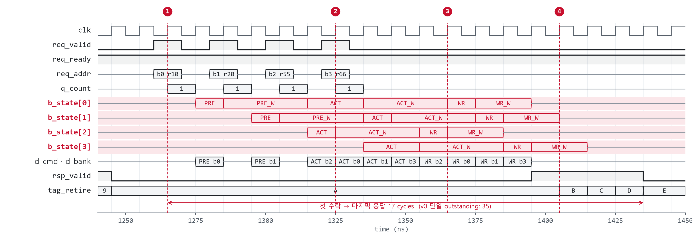

# Scheduler latency & throughput note / 스케줄러·처리량 노트

PPA-style note for the three controller versions. Timing from `dram_pkg` / `docs/spec.md` (own scaled model, not JEDEC). Cycle counts come from the testbenches; area and timing from `make ppa`. Numbers for v2 are from commit `c1b8248`, for v1 from `2eabd33` (latency, random traffic) and `fa08330` (PPA).

| Version | Structure |
|---------|-----------|
| v0 | single FSM, one request at a time |
| v1 | depth-4 queue, 4 bank engines (one request per bank), one command per cycle, one RD in flight, drain-then-REF |
| v2 | depth-8 queue with an age matrix, command-level FR-FCFS scheduler, up to 4 RDs in flight, one REF owed per tREFI (PREA then REF) |

---

## 1. Isolated latency (cycles)

Accept → response handshake with `rsp_ready = 1`, one request at a time from `tb_mem_ctrl`.

| Class | v0 | v1 | v2 | Why v2 differs from v1 |
|-------|---:|---:|---:|-------------------------|
| Page hit RD | 4 | 6 | 5 | no dispatch stage; the queue stage (+1) remains |
| Closed-bank RD | 7 | 10 | 8 | no wait→issue handoff: RD goes on the edge tRCD ends |
| Closed-bank WR | 6 | 9–12 | 6 | same, and a WR answers when its data goes out (WL) |
| Row-conflict RD | 11 | 14 | 11 | no handoff after PRE or ACT |
| Row-conflict WR | 10 | 13–14 | 9 | same |

## 2. Throughput

### Back-to-back requests (no gap, no back-pressure, seed 1, 5,000 requests)

Data bus busy = cycles with read or write data on the DRAM bus.

| Traffic | v1 | v2 | v2 latency avg |
|---------|---:|---:|---:|
| row hit, reads only | 19.9% | 66.7% | 18.7 |
| row hit, writes only | 51.1% | 63.8% | 18.4 |
| row hit, half and half | 33.3% | 50.8% | 25.5 |
| sequential, reads only | 15.0% | 50.5% | 18.8 |
| random, reads only | 15.8% | 23.3% | 47.8 |
| mixed patterns, half and half | 14.1% | 18.5% | 63.3 |

What limits v2:

- **Refresh, about a third of the time.** Every tREFI (64) the controller precharges all banks, waits tRP and tRFC, and reopens the rows: about 25 cycles. The scaled model's tRFC/tREFI is 12/64, far above a real device, so refresh weighs more here than in silicon. Per-bank refresh is the lever.
- **Bus turnaround.** Each RD↔WR switch costs tWTR or tRTW (4 cycles): half-and-half traffic drops from 64–67% to 51%. Batching writes (write drain) is the lever.
- **One command bus.** A random-address request needs PRE, ACT and RD: three command slots for one data beat, so at most about 33%. Separate row and column command buses (as in HBM) are the lever.

### Random regression (request gap 0–2 cycles, 50 seeds per pattern)

| Pattern | v1 busy | v2 busy | v1 latency | v2 latency | v1 REF interval | v2 REF interval |
|---------|---:|---:|---:|---:|---:|---:|
| seq | 12.3% | 26.9% | 36.0 | 47.2 | 109.1 | 63.8 |
| rowhit | 29.1% | 34.5% | 31.6 | 34.5 | 87.9 | 63.9 |
| mixed | 13.8% | 18.4% | 43.1 | 69.3 | 120.2 | 63.7 |
| rand | 17.4% | 20.1% | 42.4 | 62.3 | 113.7 | 63.6 |
| hotbank | 8.7% | 10.2% | 50.2 | 102.8 | 133.6 | 63.8 |
| stride | 7.5% | 8.8% | 51.9 | 103.9 | 135.0 | 63.8 |

v2 moves more data on every pattern while paying refresh on time and keeping four timing rules v1 skipped (tRRD, tFAW, tWTR, tRTW). Its average latency under this load is higher: the deeper queue (8 instead of 4) counts more waiting from the moment of acceptance (Little's law), and refresh runs about twice as often. The `depth4` build brings the average back to 44.5 cycles.

### Parameter sweep (all six patterns averaged, `make regress`)

| Build | Data bus busy | Latency avg |
|-------|---:|---:|
| default (FR-FCFS, depth 8, 4 RDs, starvation 160) | 19.8% | 70.0 |
| FCFS | 19.4% | 70.3 |
| starvation limit 24 | 18.7% | 72.1 |
| one RD in flight | 16.9% | 75.5 |
| depth 4 | 18.4% | 44.5 |

Read pipelining is worth about 15% here (and 3.4× on read streams above). FR-FCFS adds little under this traffic because refresh closes every row each tREFI.

## 3. Area and timing (`make ppa`, Nangate45 typical)

| | v0 | v1 (`fa08330`) | v2 first cut (`893c9a4`) | v2 (`c1b8248`) |
|---|---:|---:|---:|---:|
| Area (µm²) | 1,208 | 9,692 | 14,351 | 13,478 |
| FF | 131 | 1,072 | 1,216 | 1,344 |
| reg2reg (ns) | 0.809 | 2.880 | 6.597 | 2.753 |
| ≈ fmax (MHz) | 1,182 | 343 | 151 | 357 |

The first v2 cut picked "the oldest request" with a loop that compared `tag − tag_retire` against the running best: eight entries in series, used three times per cycle, about 100 cells deep. The age matrix in `mc_queue` (`q_older[j][i]`, written at each push) makes the oldest member of any set a single AND-OR level. The decisions are unchanged (the regression numbers match to the last digit).

ABC maps without a timing target, so its result moves with small netlist changes: the same logic before an unused port was removed gave 2.423 ns (406 MHz). Every column above is `make ppa` rerun on that commit; differences under about 10% are not read as structural.

## 4. Tradeoffs (v2)

| Choice | Benefit | Cost |
|--------|---------|------|
| Command-level scheduler | issues each request's next command as soon as it is legal; serves several hits to one row back to back | per-cycle logic over 8 entries |
| FR-FCFS + row protection | row hits first: higher hit rate and throughput | needs a starvation guard |
| Age matrix | oldest-of-set in one level; 357 MHz | 128 FF |
| Depth-8 queue | 5–15% more throughput than depth 4 | latency under load, area |
| Up to 4 RDs in flight | 3.4× on read streams | read-return FIFO |
| One REF per tREFI, PREA first | protocol-correct; average interval exactly tREFI | closes every row each tREFI (~25 cycles) |
| In-order responses via tags | simple host contract | 16 × 32b buffer, 44% of the FFs |

**Next levers:** write drain, separate row/column command buses, per-bank refresh and bank groups, page policies and address maps, a smaller response buffer.

---

## Appendix: v1 measurements

4 writes to 4 banks, first accept → last response: v0 35 cycles, v1 17 cycles (2.06×), v2 15 cycles (the host task accepts only every 2 cycles in this scenario, which bounds all three). v1 refresh blocked requests for 23.3% of the `make sim` run (194 of 834 cycles after reset, 10 REFs), because each REF waited for the queue to drain and the counter reloaded only after the REF.

v1, TB scenario 4, commit `6049e5a`. ① b0 accept; b1–b3 arrive 2 cycles apart and dispatch at once. ② When b0 and b2 both wait for ACT, `rr_ptr` sends b2 first; a command goes out every cycle here. ③ b2's WR (bank was closed) finishes before b0 and b1, which need PRE. ④ Responses leave in tag order (b0 → b1 → b2 → b3) over 4 cycles; b2 waits in the buffer.
