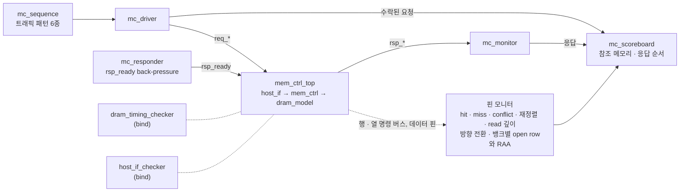
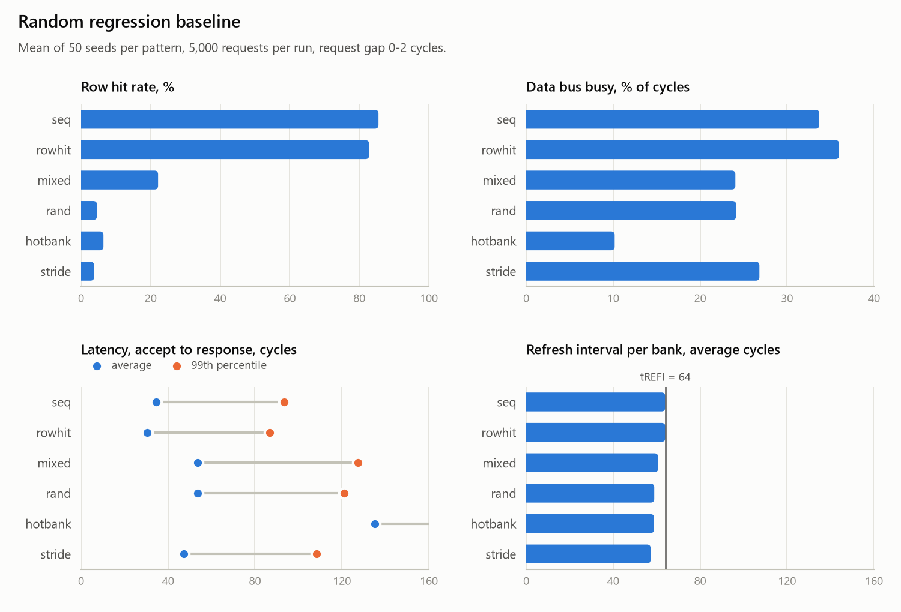

# 검증 계획과 결과

`mem_ctrl` v4를 무엇으로, 어떤 규칙으로 검증하는지, 그리고 그 결과를 정리한다. 수치는 모두 commit `ab9d522` 기준이다(Verilator 5.052, WSL Ubuntu). v3 시절의 같은 문서는 commit `57ad7df`, v2 시절은 `4010a10`, v1 시절은 `087dd45`에 있다.

## 구조



- **bind 체커 두 개**
  - RTL과 TB를 고치지 않고 [`tb/mc_bind.sv`](../tb/mc_bind.sv)로 붙는다.
  - directed TB(`make sim`)와 랜덤 TB가 같은 체커를 쓴다.
  - 시뮬레이션이 끝나면 체커 결과가 판정에 들어간다.
- **랜덤 TB**는 UVM의 역할 구분을 라이브러리 없이 SV class로 옮겼다.
  - 클래스: [`tb/mc_tb_pkg.sv`](../tb/mc_tb_pkg.sv)
  - top: [`tb/tb_mem_ctrl_rand.sv`](../tb/tb_mem_ctrl_rand.sv). top은 `mem_ctrl` 파라미터를 빌드 시점에 넘긴다(`verilator -GP_FR_FCFS=0` 등).
- **directed TB**([`tb/tb_mem_ctrl.sv`](../tb/tb_mem_ctrl.sv))는 시나리오 6개다. v3에서 포워딩 시나리오를 더했고, 주소는 기본 매핑(XOR)의 역으로 만든다.

## 1. DRAM 타이밍 · 프로토콜 체커

[`tb/dram_timing_checker.sv`](../tb/dram_timing_checker.sv)는 `dram_model`의 두 명령 버스(행: ACT · PRE · PREA · REF · REFpb, 열: RD · WR)와 데이터 핀만 보고 open row, 명령 시각, 뱅크별 refresh와 RAA를 따로 재구성한다. `mem_ctrl` 내부는 읽지 않으므로 스케줄러 버그가 스케줄러 자신의 bookkeeping 뒤에 숨지 못한다.

한 엣지에 두 버스의 명령이 같이 오면 열 명령을 먼저, 행 명령을 나중에 본다. 그래서 같은 뱅크에 PRE와 RD가 같은 엣지에 나가면 tRTP 위반으로, ACT와 RD가 같이 나가면 "닫힌 뱅크에 RD/WR"로 잡힌다.

간격은 두 이벤트를 샘플한 클럭 엣지 사이의 사이클 수다. 위반은 모두 실패로 센다. v1 시절에는 refresh 두 항목을 알려진 문제로 따로 셌지만(waived), v2에서는 끈다.

| 규칙 | 조건 |
| --- | --- |
| tRCD | ACT → 같은 뱅크 RD/WR ≥ 3 |
| tRP | PRE/PREA/auto-precharge → 같은 뱅크 ACT ≥ 3, → REF · REFpb ≥ 3 |
| tRAS | ACT → PRE/PREA ≥ 6 |
| tRC | ACT → 같은 뱅크 ACT ≥ 9 |
| tRTP | RD → PRE/PREA ≥ 2 |
| tWR | WR → PRE/PREA ≥ WL + 1 + tWR = 4 |
| tRRD_S / tRRD_L | ACT → 다른 뱅크 ACT ≥ 2, 같은 그룹이면 ≥ 3. REFpb도 tRRD_S에서는 ACT로 센다 |
| tFAW | 다섯 번째 ACT ≥ 앞선 네 번째 ACT + 8 |
| tCCD_S / tCCD_L | RD/WR → RD/WR ≥ 1, 같은 그룹이면 ≥ 2 |
| tWTR_S / tWTR_L | WR → RD ≥ 2, 같은 그룹이면 ≥ 4 |
| tRTW | RD → WR ≥ 4 |
| tRFC | REF → 다음 명령(어느 버스든) ≥ 12 |
| tRFCpb | REFpb → 그 뱅크의 ACT · REFpb ≥ 8 |
| RL | RD → 읽기 데이터(`data_valid`) = 정확히 3 |
| WL | WR → 쓰기 데이터(`wdata_en`) = 정확히 1 |
| 프로토콜 10종 | 열린 뱅크에 ACT, 닫힌 뱅크에 RD/WR, RD 없는 읽기 데이터, 오지 않은 읽기 데이터, WR 없는 쓰기 데이터, 오지 않은 쓰기 데이터, 열린 row가 있는 REF, 열린 뱅크에 REFpb, 뱅크당 밀린 refresh > 8, RAA가 12 이상인 뱅크에 ACT |

- auto-precharge가 실린 RD/WR가 오면 체커는 장치가 precharge하는 엣지를 직접 계산한다: max(ACT + tRAS, RD + tRTP 또는 WR + WL + 1 + tWR). 그 뱅크는 바로 닫힌 것으로 보고, 다음 ACT와 REF의 tRP를 그 엣지부터 잰다.
- 밀린 refresh는 뱅크마다 "지난 tREFI 주기 수 − 그 뱅크가 받은 refresh 수"다(REF는 모든 뱅크, REFpb는 그 뱅크). 한도 8은 DDR4가 허용하는 REF postpone 개수를 빌린 값이다. refresh 간격도 뱅크마다 재서, all-bank와 per-bank 모두 평균이 tREFI가 된다.
- RAA는 체커가 따로 센다: ACT마다 +1, 그 뱅크의 refresh마다 −4(0 아래로는 안 간다). 12에 닿은 뱅크에 ACT가 오면 위반이다.
- 열 버스에는 row가 없다. RD/WR가 다른 row에 간 버그는 체커가 아니라 TB의 짝짓기(열린 row로 계산한 주소가 어느 요청과도 맞지 않음)에서 잡힌다.
- `--assert` 없이 빌드하면 assertion이 꺼진 채 통과할 수 있다. 그래서 시작할 때 assertion이 켜졌는지 확인하고, 꺼져 있으면 실패로 보고한다.

## 2. 호스트 valid/ready SVA

[`tb/host_if_checker.sv`](../tb/host_if_checker.sv)

| 이름 | 종류 | 내용 |
| --- | --- | --- |
| `a_req_hold` | assert, 호스트 규칙 | `req_ready` 전까지 `req_valid`와 payload 유지 |
| `a_rsp_hold` | assert | `rsp_ready` 전까지 `rsp_valid`와 `rsp_rdata` 유지 |
| `a_known` | assert | 리셋 뒤 handshake 출력에 X/Z 없음 (4-state 시뮬레이터에서 의미가 있다) |
| `a_rsp_err` | assert | v4는 `rsp_err`를 내지 않음 |
| `c_req_stall` · `c_req_b2b` · `c_rsp_stall` · `c_rsp_stall_16` · `c_rsp_b2b_4` | cover | 요청 대기, 연속 수락, 응답 대기, 16사이클 이상 응답 대기, 응답 4연속 |

## 3. 랜덤 TB

| class | 역할 |
| --- | --- |
| `mc_sequence` | 패턴별 주소를 만든다. 최근 쓴 주소를 일정 비율로 다시 써서 RAW · WAW를 만든다. 요청마다 빌드의 주소 매핑으로 DRAM 위치(bank, row, col)를 붙인다 |
| `mc_driver` | 하강 엣지에서 `req_*`를 바꾸고, 상승 엣지의 `req_valid && req_ready`로 수락 시점을 기록한다. 연속 수락도 된다 |
| `mc_responder` | `rsp_ready`를 1–24사이클씩 랜덤하게 내린다 |
| `mc_monitor` | 호스트가 받은 응답을 모은다 |
| `mc_scoreboard` | 수락된 요청의 응답을 참조 메모리로 예측하고, 응답 순서 · 데이터 · `rsp_err`를 비교한다. RD/WR가 아직 핀에 나가지 않은 요청 목록을 따로 둔다 |
| `mc_coverage` | 기능 bin 32개 |
| `mc_env` | 생성, 실행, hang 감시(4,000사이클 무응답), 마지막 응답 뒤 쓰기 drain 확인(2,000사이클), 보고, CSV 기록 |

TB top의 핀 모니터는 다음을 한다.
- **분류**: RD/WR마다 hit, miss, conflict로 나눈다. 직전 열 명령 이후 그 뱅크에 ACT가 없으면 hit, ACT만 있으면 miss, PRE 뒤 ACT가 있으면 conflict다. PREA와 REF로 닫힌 row는 refresh 때문이라 conflict로 세지 않는다.
- **짝짓기**: RD/WR를 DRAM 위치와 방향이 같은 가장 오래된 대기 요청과 짝짓는다. 요청의 DRAM 위치는 TB가 따로 구현한 주소 매핑(`tb_loc`, 비트 슬라이스 대신 나눗셈과 나머지)으로 구하고, 명령의 row는 행 버스의 ACT로 따라간 뱅크별 open row다. RTL 매핑이나 row 관리의 버그는 짝이 없는 명령으로 드러난다.
  - 더 오래된 요청이 아직 자기 RD/WR를 기다리는데 이 요청이 먼저 나가면 **재정렬**로 센다.
  - 짝이 없는 명령, 자기 RD보다 먼저 온 읽기 응답, 끝까지 핀에 나가지 않은 요청은 오류다.
- **분류 보정**: auto-precharge, REFpb로 닫힌 뱅크의 다음 ACT는 miss로 센다. 기다리는 요청이 없는 뱅크의 PRE(timer, refresh)는 conflict 원인으로 세지 않는다.
- **두 버스와 RFM**: 한 엣지의 열 명령을 행 명령보다 먼저 처리한다(모델, 체커와 같은 순서). 두 버스가 같이 쓰인 엣지, 다른 뱅크 그룹으로 연달아 나간 열 명령, REFpb와 RFM, RAA 한도 도달을 bin으로 센다.
- **방향 전환**: 열 명령의 방향이 RD ↔ WR로 바뀐 횟수를 센다.
- **read 깊이**: 데이터가 아직 오지 않은 RD 수를 세서 read 파이프라인 bin을 맞힌다.
- **데이터 비트**: 읽기 데이터와 쓰기 데이터(`wdata_en`)가 오간 사이클을 센다.

**기대값 예측 근거**: read는 자기보다 먼저 수락된 모든 write를 봐야 한다. 컨트롤러는 이를 세 가지로 지킨다: 같은 주소의 write끼리는 들어온 순서대로 나가고(`q_dep`), 쓰기 큐에 같은 주소가 있는 read는 그 데이터로 바로 응답하고(포워딩), 읽기 큐에 같은 주소가 있는 write는 포트에서 기다린다. 그래서 수락 순서대로 참조 메모리를 갱신하면 각 read의 기대값이 정해진다. write의 응답 데이터는 0이고, 써 본 적 없는 주소의 read는 모델의 리셋 값인 0을 기대한다.

**posted write와 포워딩 판정**:
- driver는 수락한 요청을 그 엣지 다음 하강 엣지에 scoreboard로 넘긴다. 그때는 핀 모니터가 수락 엣지의 명령을 이미 기록했으므로, scoreboard는 컨트롤러가 수락 엣지에 쓰기 큐에 가지고 있던 쓰기를 정확히 안다: 아직 WR가 안 나간 쓰기, 그리고 WR가 바로 그 엣지에 나간 쓰기다(주소별 마지막 WR 엣지로 판정).
- 그런 쓰기가 있는 read는 포워딩되어야 한다. DRAM에 RD가 나가면 짝이 없는 명령으로, 없는 read가 RD 없이 응답하면 "RD보다 먼저 온 응답"으로 실패한다.
- write의 응답은 바로 오지만 WR가 핀에 나가는지는 따로 본다. 마지막 응답 뒤 2,000사이클 안에 나가지 않은 요청이 남으면 실패다.
- 핀 모니터는 엣지 번호를 TB top이 모듈에서 직접 읽은 `hif.cyc`로 받는다. class 핸들로 읽은 `vif.cyc`는 같은 엣지의 갱신 전 값이라는 보장이 없어서, 첫 회귀에서 포워딩 판정이 한 사이클 어긋났다.

**난수**: xorshift64*로 직접 만든다. seed가 같으면 시뮬레이터와 무관하게 같은 요청열이 나온다.

### 트래픽 패턴

| 패턴 | 주소 | 성격 |
| --- | --- | --- |
| `seq` | 연속 호스트 주소 | 같은 row가 이어져 hit가 많다. 16 word마다 매핑에 따라 다음 뱅크나 다음 row |
| `rowhit` | 뱅크마다 고정 row 하나, col은 랜덤 (DRAM 좌표로 만든다) | hit가 가장 많고 뱅크가 고르게 섞인다 |
| `mixed` | 요청마다 나머지 다섯 패턴 중 하나 | 혼합 |
| `rand` | 14비트 호스트 주소 균등 랜덤 | 대부분 conflict |
| `hotbank` | 80%가 bank 0, row는 랜덤 (DRAM 좌표로 만든다) | 한 뱅크에 conflict가 몰린다 |
| `stride` | 16 word 간격의 호스트 주소 | bank:row:col에서는 같은 뱅크의 다음 row(전부 conflict), XOR · row:bank:col에서는 네 뱅크를 돈다 |

`seq` · `rand` · `stride`는 호스트 주소를 걷으므로 주소 매핑이 어느 뱅크에 닿을지 정한다. `rowhit` · `hotbank`는 매핑의 역함수(`tb_addr`)로 주소를 만들어 어느 매핑에서나 같은 뜻을 갖는다.

공통 설정은 read 50%, 요청 사이 idle 0–2사이클, `rsp_ready` stall(사이클마다 10% 확률로 시작, 1–24사이클), 최근 쓴 주소 재사용 20%다. plusarg로 바꿀 수 있다(`+RD_PCT`, `+GAP_MAX`, `+BP_PCT`, `+BP_MAX`, `+REUSE_PCT`).

### 빌드 변형

기본 빌드만 돌리면 다른 파라미터 뒤의 코드는 실행되지 않는다. 예를 들어 FCFS 분기, starvation 보호, close · timer 정책, 다른 주소 매핑, 명령 버스 하나, all-bank refresh가 그렇다. 그래서 `make regress`와 `make cov`는 변형 15개를 함께 빌드해 돌린다(`make -j`로 병렬 빌드).

| 빌드 | Verilator 옵션 | 목적 |
| --- | --- | --- |
| `default` | – | FR-FCFS, 읽기 8 + 쓰기 8, 쓰기 모아 보내기, open page, XOR 매핑, 두 명령 버스, per-bank refresh, RFM, RD 4개, starvation 160 |
| `bus1` | `-GP_CMD_BUS=1` | 명령 버스 하나 (v3 방식) |
| `refab` | `-GP_REF_MODE=0` | all-bank refresh (PREA → REF) |
| `bus1_refab` | `-GP_CMD_BUS=1 -GP_REF_MODE=0` | v3와 같은 스케줄링을 뱅크 그룹이 있는 장치에서 |
| `rfm_late` | `-GP_RFM_EARLY=0` | RFM을 한도에서만: ACT 금지와 강제 RFM 경로 |
| `fcfs` | `-GP_FR_FCFS=0` | FCFS 선택과 older-hit 보호, 두 버스에서 같은 뱅크 PRE 막기 |
| `starve24` | `-GP_STARVE_LIMIT=24` | starvation 보호(읽기, 쓰기)가 자주 발동 |
| `rdpipe1` | `-GP_RD_PIPE=1` | read를 한 번에 하나 (v1과 같은 조건) |
| `depth4` | `-GP_DEPTH=4` | 큐마다 4 엔트리 (모두 8, v2와 같은 수) |
| `nodrain` | `-GP_WDRAIN=0` | 읽기와 쓰기를 오래된 순으로 (v2 방식), 두 큐 사이 age matrix |
| `fcfs_nodrain` | `-GP_FR_FCFS=0 -GP_WDRAIN=0` | 두 큐에 걸친 FCFS older-hit 보호 |
| `close` | `-GP_PAGE_POLICY=1` | auto-precharge와 체커의 암묵 precharge 계산 |
| `timer` | `-GP_PAGE_POLICY=2` | idle row PRE |
| `map_brc` · `map_rbc` · `map_rcb` | `-GP_ADDR_MAP=0/1/2` | 다른 주소 매핑 (`map_brc`는 v2 매핑) |

## 4. 회귀 결과

`make regress SEEDS=50 N=5000`의 구성은 다음과 같다. 모두 1,200회, 600만 요청이다. 빌드와 실행을 `JOBS`(기본: 코어 수)개씩 병렬로 돌려, 6코어 WSL에서 실행이 약 2분 걸린다(빌드 캐시가 있을 때).
- 기본 빌드: 패턴 6 × seed 50 × 요청 5,000
- 변형 빌드 15개: 각각 패턴 6 × seed 10

| 빌드 | 실행 | PASS | 데이터 불일치 | 규칙 위반 | 데이터 버스 | latency 평균 | 읽기 latency | RD↔WR 전환 |
| --- | ---: | ---: | ---: | ---: | ---: | ---: | ---: | ---: |
| default | 300 | 300/300 | 0 | 0 | 25.8% | 59.1 | 59.7 | 1,537 |
| bus1 | 60 | 60/60 | 0 | 0 | 25.0% | 61.3 | 61.8 | 1,480 |
| refab | 60 | 60/60 | 0 | 0 | 24.0% | 64.4 | 65.0 | 1,358 |
| bus1_refab | 60 | 60/60 | 0 | 0 | 23.2% | 66.8 | 67.6 | 1,310 |
| rfm_late | 60 | 60/60 | 0 | 0 | 25.8% | 59.3 | 59.8 | 1,535 |
| fcfs | 60 | 60/60 | 0 | 0 | 25.8% | 59.2 | 59.8 | 1,517 |
| starve24 | 60 | 60/60 | 0 | 0 | 24.7% | 64.3 | 65.1 | 1,649 |
| rdpipe1 | 60 | 60/60 | 0 | 0 | 23.6% | 63.6 | 64.4 | 1,487 |
| depth4 | 60 | 60/60 | 0 | 0 | 25.6% | 28.7 | 31.6 | 1,805 |
| nodrain | 60 | 60/60 | 0 | 0 | 25.9% | 58.4 | 60.6 | 1,896 |
| fcfs_nodrain | 60 | 60/60 | 0 | 0 | 25.9% | 58.6 | 60.7 | 1,891 |
| close | 60 | 60/60 | 0 | 0 | 26.0% | 58.5 | 59.0 | 1,528 |
| timer | 60 | 60/60 | 0 | 0 | 25.9% | 58.8 | 59.3 | 1,519 |
| map_brc | 60 | 60/60 | 0 | 0 | 20.5% | 82.3 | 83.3 | 1,388 |
| map_rbc | 60 | 60/60 | 0 | 0 | 26.1% | 58.7 | 59.2 | 1,535 |
| map_rcb | 60 | 60/60 | 0 | 0 | 24.6% | 63.5 | 64.3 | 1,591 |

<sub>데이터 버스와 latency는 패턴별 평균을 다시 평균한 값이다. latency 평균은 쓰기를 포함한다. 쓰기는 수락 즉시 응답이 준비되지만 응답이 요청 순서대로 나가므로, 앞선 읽기를 기다린 시간이 들어간다. RD↔WR 전환은 실행 한 번(5,000건)당 평균이다.</sub>

### 기능 커버리지

32개 bin이 모두 맞았다(1,200회 합계). 오른쪽 열은 그 bin을 한 번이라도 맞힌 실행 수다.

| bin | 합계 | 맞힌 실행 |
| --- | ---: | ---: |
| read hit / miss / conflict | 894,831 / 734,816 / 1,213,055 | 1200 / 1200 / 961 |
| write hit / miss / conflict | 1,102,895 / 689,846 / 1,212,800 | 1200 / 1200 / 966 |
| 4개 · 8개 이상 in flight | 5,882,190 · 5,331,290 | 1200 · 1200 |
| 15개 in flight (tag 한도) | 786,858 | 1192 |
| 네 뱅크 모두 대기 중 | 1,196,240 | 1142 |
| 쓰기 큐에서 포워딩된 읽기 · 큐에 있는 쓰기 뒤의 같은 주소 쓰기 | 151,757 · 143,018 | 1200 · 1200 |
| 큐에 있는 읽기 때문에 포트에서 기다린 쓰기 | 470,830 | 1200 |
| tag 한도에서 요청 대기 | 13,517,082 | 1192 |
| 응답이 16사이클 이상 대기 | 299,783 | 1200 |
| 응답이 남은 채 refresh · `rsp_ready`가 내려간 채 refresh | 1,703,953 · 663,627 | 1200 · 1200 |
| 재정렬 (뒤에 온 요청의 RD/WR가 먼저 나감) | 3,386,363 | 1200 |
| DRAM 버스에 RD 2개 · 3개 동시 | 942,730 · 50,449 | 1140 · 793 |
| REF 앞의 PREA (all-bank 빌드) | 40,059 | 120 |
| 아무 요청도 없을 때 refresh · 4개 이상 대기 중 refresh | 16,949 · 1,668,634 | 1195 · 1200 |
| WR 4개 이상 연속 (쓰기 묶음) | 319,245 | 1200 |
| auto-precharge가 실린 RD/WR | 211,907 | 60 |
| 기다리는 요청이 없는 뱅크의 PRE (timer, refresh) | 652,684 | 1078 |
| 행 · 열 명령이 한 엣지에 | 1,359,346 | 1080 |
| per-bank refresh · 그 엣지에 다른 뱅크의 RD/WR | 1,674,822 · 111,515 | 1160 · 1053 |
| 다른 뱅크 그룹으로 연달아 나간 RD/WR | 566,659 | 1185 |
| RAA 4 이상인 뱅크의 REFpb (RFM) · RAA 12 도달 | 709,148 · 131,879 | 979 · 800 |

- conflict가 없는 실행은 대부분 `rowhit`이다. 뱅크마다 row가 하나뿐이다.
- 두 버스 bin이 없는 120회는 `bus1` · `bus1_refab`, per-bank refresh가 없는 120회는 `refab` · `bus1_refab`, PREA가 있는 120회는 그 두 all-bank 빌드다.
- RAA 한도는 hotbank와 랜덤 계열 패턴에서 닿는다. 한도에 닿아도 위반은 0이었다.

### 성능 기준선

<p align="center"></p>

| 패턴 | row hit | 데이터 버스 사용률 | latency 평균 / p99 | 뱅크당 refresh 간격 | 최대로 밀린 refresh |
| --- | ---: | ---: | ---: | ---: | ---: |
| seq | 85.5% | 33.7% | 34.6 / 93.4 | 63.9 | 1 |
| rowhit | 82.8% | 36.0% | 30.3 / 86.7 | 64.0 | 1 |
| mixed | 22.1% | 24.1% | 53.6 / 127.5 | 60.7 | 1 |
| rand | 4.5% | 24.1% | 53.5 / 121.0 | 58.9 | 1 |
| hotbank | 6.4% | 10.2% | 135.1 / 239.9 | 58.8 | 1 |
| stride | 3.7% | 26.8% | 47.3 / 108.3 | 57.2 | 1 |

<sub>기본 빌드, seed 50개 평균이다. "최대로 밀린 refresh"만 최댓값이다. 데이터 버스 사용률은 첫 수락부터 마지막 응답까지의 사이클 중 읽기 데이터나 쓰기 데이터가 오간 사이클의 비율이다. refresh 간격이 64보다 짧은 패턴은 RFM이 넣은 REFpb도 세기 때문이다. v3와의 비교는 [README](../README.md#같은-트래픽에서-v3와-v4)에 있다.</sub>

## 5. 코드 커버리지

`make cov`는 다음 실행을 각각 커버리지 빌드로 돌린다. 빌드 17개와 실행을 `JOBS`개씩 병렬로 돌린다.
- directed 1회
- 기본 빌드의 랜덤 18회(패턴 6 × seed 3)
- 변형 빌드 15개마다 6회(패턴 6 × seed 1)

[`tools/cov_summary.py`](../tools/cov_summary.py)가 이 결과를 합친다.
- 합치는 기준은 소스 지점이다. TB마다 계층 경로가 다르고, 파라미터를 바꾼 빌드는 모듈 이름에 `__D8` 같은 접미사가 붙기 때문이다.
- 지점 하나는 어느 실행에서든 한 번 맞으면 덮인 것으로 센다.

| 범위 | Line | Branch | Toggle |
| --- | ---: | ---: | ---: |
| 컨트롤러 (`mem_ctrl` + `mc_*`) | 94.8% → **98.7%** | 81.8% → **98.2%** | 48.5% → **93.1%** |
| `mc_sched` | 91.9% → **100%** | 62.5% → **96.9%** | 43.2% → **91.5%** |
| `mc_chan` (뱅크 그룹 타이밍) | 100% → **100%** | 96.2% → **100%** | 46.3% → **52.1%** |
| `mc_refresh` | 100% → **100%** | 83.3% → **91.7%** | 89.1% → **94.0%** |
| RTL 전체 (`dram_model` 포함) | 88.9% → **96.0%** | 77.7% → **94.1%** | 53.9% → **93.7%** |

<sub>화살표 왼쪽은 directed만, 오른쪽은 랜덤을 모두 더한 값이다. Verilator의 expression 커버리지는 표에서 뺐다. 루프 안의 식에서 분명히 실행된 항까지 미도달로 세는 경우가 있어서다.</sub>

남은 구멍은 `python3 tools/cov_summary.py --holes <모듈> build/cov/*.dat`로 볼 수 있다.

| 위치 | 이유 |
| --- | --- |
| `mc_sched.sv:135–136` | `older()` 함수의 분기 두 개. Verilator가 루프를 펼치면서 상수인 큐 번호로 분기를 접어 카운터가 0으로 남는다(같은 줄의 else 분기는 `nodrain` · `fcfs_nodrain` 빌드에서 434,345회). 두 큐에 걸친 비교는 그 빌드에서 돌았고 결과가 scoreboard와 모두 맞았다 |
| `mc_refresh.sv:56` | 밀린 refresh 카운터의 포화(15). `REF_URGENT` 4에서 멈추므로 설계상 도달하지 않는다 |
| `mc_resp.sv:100` | WL이 1보다 클 때 쓰는 쓰기 파이프 단. WL 1에서는 쓰이지 않는다 |
| `mc_chan`의 toggle(52%) | 카운터 상위 비트가 스펙 값보다 넓다(tRFC 11까지 세는 5 bit 폭을 모든 카운터가 쓴다) |
| `dram_model`의 오류 경로 | (닫힌 row 접근, 열린 뱅크에 ACT · REFpb, tRFC · tRFCpb 안의 명령, 짝이 없는 쓰기 데이터). 컨트롤러가 그런 명령을 내지 않았다는 뜻이고, 모델을 직접 모는 negative test가 남았다 |

## 6. 실행

```bash
make sim                                    # directed 6개 + bind 체커
make sim-rand PATTERN=hotbank SEED=7 N=5000 # 랜덤 1회 (기본 빌드)
make regress SEEDS=50 N=5000                # 기본 + 변형 15개, build/regress/regress.csv
make cov N=5000                             # 커버리지: directed만 / directed + 랜덤
make ppa                                    # 면적과 타이밍 (README의 PPA 절)
python tools/regress_report.py build/regress/regress.csv --plots docs/images \
  --baseline docs/data/v3_regress_baseline.csv --baseline-label "v3 (1b0943a)" \
  --label v4 --compare-name regress_v3_v4.png
```

- 실패한 랜덤 실행은 `build/regress/<빌드>_<패턴>_seed<번호>.log`에 로그가 남는다.
- 같은 빌드에서 `+PATTERN`과 `+SEED`를 같게 주면 같은 요청열이 재현된다.

## 7. 한계

- class 기반 랜덤 TB는 Verilator 5.052에서만 돌려 봤다. ModelSim-Altera 무료판은 class와 concurrent SVA 지원이 제한적일 수 있다.
- `dram_model` 오류 경로를 일부러 일으키는 negative test가 아직 없다.
- 성능 수치는 자체 축소 타이밍 기준이다. tRFC/tREFI가 12/64라 refresh 비용이 실제 DRAM보다 훨씬 크다. 절대값보다 버전과 정책 사이의 비교에 쓴다.
