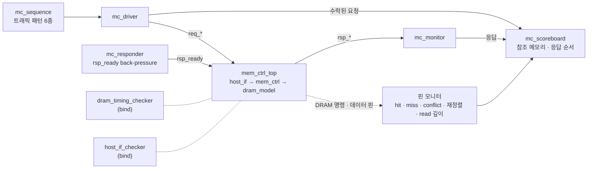

# 검증 계획과 결과

`mem_ctrl` v2를 무엇으로, 어떤 규칙으로 검증하는지, 그리고 그 결과를 정리한다. 수치는 모두 commit `c1b8248` 기준이다(Verilator 5.052, WSL Ubuntu). v1 시절의 같은 문서는 commit `087dd45`에 있다.

## 구조



- **bind 체커 두 개**
  - RTL과 TB를 고치지 않고 [`tb/mc_bind.sv`](../tb/mc_bind.sv)로 붙는다.
  - directed TB(`make sim`)와 랜덤 TB가 같은 체커를 쓴다.
  - 시뮬레이션이 끝나면 체커 결과가 판정에 들어간다.
- **랜덤 TB**는 UVM의 역할 구분을 라이브러리 없이 SV class로 옮겼다.
  - 클래스: [`tb/mc_tb_pkg.sv`](../tb/mc_tb_pkg.sv)
  - top: [`tb/tb_mem_ctrl_rand.sv`](../tb/tb_mem_ctrl_rand.sv). top은 `mem_ctrl` 파라미터를 빌드 시점에 넘긴다(`verilator -GP_FR_FCFS=0` 등).
- **directed TB**([`tb/tb_mem_ctrl.sv`](../tb/tb_mem_ctrl.sv))는 시나리오 5개를 유지한다.

## 1. DRAM 타이밍 · 프로토콜 체커

[`tb/dram_timing_checker.sv`](../tb/dram_timing_checker.sv)는 `dram_model`의 명령 핀과 데이터 핀만 보고 open row와 명령 시각을 따로 재구성한다. `mem_ctrl` 내부는 읽지 않으므로 스케줄러 버그가 스케줄러 자신의 bookkeeping 뒤에 숨지 못한다.

간격은 두 이벤트를 샘플한 클럭 엣지 사이의 사이클 수다. 위반은 모두 실패로 센다. v1 시절에는 refresh 두 항목을 알려진 문제로 따로 셌지만(waived), v2에서는 끈다.

| 규칙 | 조건 |
| --- | --- |
| tRCD | ACT → 같은 뱅크 RD/WR ≥ 3 |
| tRP | PRE/PREA → 같은 뱅크 ACT ≥ 3, PRE/PREA → REF ≥ 3 |
| tRAS | ACT → PRE/PREA ≥ 6 |
| tRC | ACT → 같은 뱅크 ACT ≥ 9 |
| tRTP | RD → PRE/PREA ≥ 2 |
| tWR | WR → PRE/PREA ≥ WL + 1 + tWR = 4 |
| tRRD | ACT → 다른 뱅크 ACT ≥ 2 |
| tFAW | 다섯 번째 ACT ≥ 앞선 네 번째 ACT + 8 |
| tCCD | RD/WR → RD/WR ≥ 1 |
| tWTR | WR → RD ≥ 4 |
| tRTW | RD → WR ≥ 4 |
| tRFC | REF → 다음 명령 ≥ 12 |
| RL | RD → 읽기 데이터(`data_valid`) = 정확히 3 |
| WL | WR → 쓰기 데이터(`wdata_en`) = 정확히 1 |
| 프로토콜 9종 | 열린 뱅크에 ACT, 닫힌 뱅크에 RD/WR, 열리지 않은 row에 RD/WR, RD 없는 읽기 데이터, 오지 않은 읽기 데이터, WR 없는 쓰기 데이터, 오지 않은 쓰기 데이터, 열린 row가 있는 REF, 밀린 REF > 8 |

- 밀린 REF는 "지난 tREFI 주기 수 − 발행한 REF 수"다. 한도 8은 DDR4가 허용하는 REF postpone 개수를 빌린 값이다.
- `--assert` 없이 빌드하면 assertion이 꺼진 채 통과할 수 있다. 그래서 시작할 때 assertion이 켜졌는지 확인하고, 꺼져 있으면 실패로 보고한다.

## 2. 호스트 valid/ready SVA

[`tb/host_if_checker.sv`](../tb/host_if_checker.sv)

| 이름 | 종류 | 내용 |
| --- | --- | --- |
| `a_req_hold` | assert, 호스트 규칙 | `req_ready` 전까지 `req_valid`와 payload 유지 |
| `a_rsp_hold` | assert | `rsp_ready` 전까지 `rsp_valid`와 `rsp_rdata` 유지 |
| `a_known` | assert | 리셋 뒤 handshake 출력에 X/Z 없음 (4-state 시뮬레이터에서 의미가 있다) |
| `a_rsp_err` | assert | v2는 `rsp_err`를 내지 않음 |
| `c_req_stall` · `c_req_b2b` · `c_rsp_stall` · `c_rsp_stall_16` · `c_rsp_b2b_4` | cover | 요청 대기, 연속 수락, 응답 대기, 16사이클 이상 응답 대기, 응답 4연속 |

## 3. 랜덤 TB

| class | 역할 |
| --- | --- |
| `mc_sequence` | 패턴별 주소를 만든다. 최근 쓴 주소를 일정 비율로 다시 써서 RAW · WAW를 만든다 |
| `mc_driver` | 하강 엣지에서 `req_*`를 바꾸고, 상승 엣지의 `req_valid && req_ready`로 수락 시점을 기록한다. 연속 수락도 된다 |
| `mc_responder` | `rsp_ready`를 1–24사이클씩 랜덤하게 내린다 |
| `mc_monitor` | 호스트가 받은 응답을 모은다 |
| `mc_scoreboard` | 요청을 수락하는 순간 참조 메모리로 응답을 예측하고, 응답 순서 · 데이터 · `rsp_err`를 비교한다 |
| `mc_coverage` | 기능 bin 22개 |
| `mc_env` | 생성, 실행, hang 감시(4,000사이클 무응답), 보고, CSV 기록 |

TB top의 핀 모니터는 다음을 한다.
- **분류**: RD/WR마다 hit, miss, conflict로 나눈다. 직전 열 명령 이후 그 뱅크에 ACT가 없으면 hit, ACT만 있으면 miss, PRE 뒤 ACT가 있으면 conflict다. PREA와 REF로 닫힌 row는 refresh 때문이라 conflict로 세지 않는다.
- **짝짓기**: RD/WR를 주소와 방향이 같은 가장 오래된 대기 요청과 짝짓는다.
  - 더 오래된 요청이 아직 자기 RD/WR를 기다리는데 이 요청이 먼저 나가면 **재정렬**로 센다.
  - 짝이 없는 명령, 그리고 자기 RD/WR보다 먼저 온 응답은 오류다.
- **read 깊이**: 데이터가 아직 오지 않은 RD 수를 세서 read 파이프라인 bin을 맞힌다.
- **데이터 비트**: 읽기 데이터와 쓰기 데이터(`wdata_en`)가 오간 사이클을 센다.

**기대값 예측 근거**: 같은 주소의 RD/WR는 들어온 순서대로 나간다(`q_dep`). WR → RD에는 tWTR, RD → WR에는 tRTW가 있어 데이터도 그 순서로 메모리에 닿는다. 그래서 수락 순서대로 참조 메모리를 갱신하면 각 read의 기대값이 정해진다. write의 응답 데이터는 0이고, 써 본 적 없는 주소의 read는 모델의 리셋 값인 0을 기대한다.

**난수**: xorshift64*로 직접 만든다. seed가 같으면 시뮬레이터와 무관하게 같은 요청열이 나온다.

### 트래픽 패턴

| 패턴 | 주소 | 성격 |
| --- | --- | --- |
| `seq` | 연속 주소 (col → row → bank 순) | 같은 row가 이어져 hit가 많다 |
| `rowhit` | 뱅크마다 고정 row 하나, col은 랜덤 | hit가 가장 많고 뱅크가 고르게 섞인다 |
| `mixed` | 요청마다 나머지 다섯 패턴 중 하나 | 혼합 |
| `rand` | 14비트 주소 균등 랜덤 | 대부분 conflict |
| `hotbank` | 80%가 bank 0, row는 랜덤 | 한 뱅크에 conflict가 몰린다 |
| `stride` | 16 word 간격 = 같은 뱅크의 다음 row | 거의 전부 conflict |

공통 설정은 read 50%, 요청 사이 idle 0–2사이클, `rsp_ready` stall(사이클마다 10% 확률로 시작, 1–24사이클), 최근 쓴 주소 재사용 20%다. plusarg로 바꿀 수 있다(`+RD_PCT`, `+GAP_MAX`, `+BP_PCT`, `+BP_MAX`, `+REUSE_PCT`).

### 빌드 변형

기본 빌드만 돌리면 다른 파라미터 뒤의 코드는 실행되지 않는다. 예를 들어 FCFS 분기와 starvation 보호가 그렇다. 그래서 `make regress`와 `make cov`는 변형 4개를 함께 빌드해 돌린다.

| 빌드 | Verilator 옵션 | 목적 |
| --- | --- | --- |
| `default` | – | FR-FCFS, 깊이 8, RD 4개, starvation 160 |
| `fcfs` | `-GP_FR_FCFS=0` | FCFS 선택과 older-hit 보호 |
| `starve24` | `-GP_STARVE_LIMIT=24` | starvation 보호가 자주 발동 |
| `rdpipe1` | `-GP_RD_PIPE=1` | read를 한 번에 하나 (v1과 같은 조건) |
| `depth4` | `-GP_DEPTH=4` | 큐 깊이 4 |

## 4. 회귀 결과

`make regress SEEDS=50 N=5000`의 구성은 다음과 같다. 모두 540회, 270만 요청이고, WSL에서 약 5분 걸린다.
- 기본 빌드: 패턴 6 × seed 50 × 요청 5,000
- 변형 빌드 4개: 각각 패턴 6 × seed 10

| 빌드 | 실행 | PASS | 데이터 불일치 | 규칙 위반 | 데이터 버스 | latency 평균 |
| --- | ---: | ---: | ---: | ---: | ---: | ---: |
| default | 300 | 300/300 | 0 | 0 | 19.8% | 70.0 |
| fcfs | 60 | 60/60 | 0 | 0 | 19.4% | 70.3 |
| starve24 | 60 | 60/60 | 0 | 0 | 18.7% | 72.1 |
| rdpipe1 | 60 | 60/60 | 0 | 0 | 16.9% | 75.5 |
| depth4 | 60 | 60/60 | 0 | 0 | 18.4% | 44.5 |

<sub>데이터 버스와 latency는 패턴별 평균을 다시 평균한 값이다.</sub>

### 기능 커버리지

22개 bin이 모두 맞았다(540회 합계). 오른쪽 열은 그 bin을 한 번이라도 맞힌 실행 수다.

| bin | 합계 | 맞힌 실행 |
| --- | ---: | ---: |
| read hit / miss / conflict | 457,480 / 289,445 / 602,055 | 540 / 540 / 450 |
| write hit / miss / conflict | 464,503 / 286,403 / 600,114 | 540 / 540 / 450 |
| 4개 · 8개 이상 in flight | 2,696,206 · 2,487,158 | 540 · 540 |
| 15개 in flight (tag 한도) | 398,367 | 522 |
| 네 뱅크 모두 in flight | 971,891 | 360 |
| 같은 주소 RAW · WAW | 116,963 · 117,130 | 540 · 540 |
| tag 한도에서 요청 대기 | 1,979,597 | 522 |
| 응답이 16사이클 이상 대기 | 185,575 | 540 |
| 응답이 남은 채 REF · `rsp_ready`가 내려간 채 REF | 274,660 · 113,167 | 540 · 540 |
| 재정렬 (뒤에 온 요청의 RD/WR가 먼저 나감) | 912,402 | 540 |
| DRAM 버스에 RD 2개 · 3개 동시 | 408,392 · 165,326 | 480 · 429 |
| REF 앞의 PREA | 230,924 | 540 |
| 아무 요청도 없을 때 REF · 4개 이상 대기 중 REF | 1,351 · 273,846 | 503 · 540 |

- conflict가 없는 90회는 `rowhit`이다. 뱅크마다 row가 하나뿐이다.
- read 3개 동시가 없는 실행은 RD 1개 빌드(`rdpipe1`)와 hit가 적은 패턴이다.

### 성능 기준선

<p align="center"></p>

| 패턴 | row hit | 데이터 버스 사용률 | latency 평균 / p99 | REF 간격 평균 | 최대로 밀린 REF |
| --- | ---: | ---: | ---: | ---: | ---: |
| seq | 82.5% | 26.9% | 47.2 / 101.8 | 63.8 | 4 |
| rowhit | 83.1% | 34.5% | 34.5 / 90.1 | 63.9 | 4 |
| mixed | 25.2% | 18.4% | 69.3 / 124.2 | 63.7 | 4 |
| rand | 6.6% | 20.1% | 62.3 / 114.8 | 63.6 | 4 |
| hotbank | 8.5% | 10.2% | 102.8 / 140.4 | 63.8 | 4 |
| stride | 6.2% | 8.8% | 103.9 / 139.3 | 63.8 | 4 |

<sub>기본 빌드, seed 50개 평균이다. "최대로 밀린 REF"만 최댓값이다. 데이터 버스 사용률은 첫 수락부터 마지막 응답까지의 사이클 중 읽기 데이터나 쓰기 데이터가 오간 사이클의 비율이다. v1과의 비교는 [README](../README.md#같은-트래픽에서-v1과-v2)에 있다.</sub>

## 5. 코드 커버리지

`make cov`는 다음 실행을 각각 커버리지 빌드로 돌린다.
- directed 1회
- 기본 빌드의 랜덤 18회(패턴 6 × seed 3)
- 변형 빌드마다 6회(패턴 6 × seed 1)

[`tools/cov_summary.py`](../tools/cov_summary.py)가 이 결과를 합친다.
- 합치는 기준은 소스 지점이다. TB마다 계층 경로가 다르고, 파라미터를 바꾼 빌드는 모듈 이름에 `__D8` 같은 접미사가 붙기 때문이다.
- 지점 하나는 어느 실행에서든 한 번 맞으면 덮인 것으로 센다.

| 범위 | Line | Branch | Toggle |
| --- | ---: | ---: | ---: |
| 컨트롤러 (`mem_ctrl` + `mc_*`) | 97.6% → **97.6%** | 96.6% → **98.9%** | 52.9% → **95.6%** |
| `mc_sched` | 100% → **100%** | 90.9% → **100%** | 60.3% → **95.2%** |
| `mc_queue` | 100% → **100%** | 100% → **100%** | 39.3% → **96.4%** |
| RTL 전체 (`dram_model` 포함) | 96.7% → **96.7%** | 91.7% → **93.5%** | 59.2% → **96.1%** |

<sub>화살표 왼쪽은 directed만, 오른쪽은 랜덤을 모두 더한 값이다. Verilator의 expression 커버리지는 표에서 뺐다. 루프 안의 식에서 분명히 실행된 항까지 미도달로 세는 경우가 있어서다.</sub>

남은 구멍은 `python3 tools/cov_summary.py --holes <모듈> build/cov/*.dat`로 볼 수 있다.

| 위치 | 이유 |
| --- | --- |
| `mc_refresh.sv:43` | 밀린 REF 카운터의 포화(15). `REF_URGENT` 4에서 멈추므로 설계상 도달하지 않는다 |
| `mc_resp.sv:92` | WL이 1보다 클 때만 쓰는 쓰기 파이프 단 |
| `dram_model.sv` 오류 경로 | 닫힌 row 접근, 열린 뱅크에 ACT, tRFC 안의 명령, 짝이 없는 쓰기 데이터. 컨트롤러가 그런 명령을 내지 않았다는 뜻이다. 모델을 직접 모는 negative test로 닫는다 |

## 6. 실행

```bash
make sim                                    # directed 5개 + bind 체커
make sim-rand PATTERN=hotbank SEED=7 N=5000 # 랜덤 1회 (기본 빌드)
make regress SEEDS=50 N=5000                # 기본 + 변형 4개, build/regress/regress.csv
make cov N=5000                             # 커버리지: directed만 / directed + 랜덤
make ppa                                    # 면적과 타이밍 (README의 PPA 절)
python tools/regress_report.py build/regress/regress.csv --plots docs/images \
  --baseline docs/data/v1_regress_baseline.csv --baseline-label "v1 (2eabd33)"
```

- 실패한 랜덤 실행은 `build/regress/<빌드>_<패턴>_seed<번호>.log`에 로그가 남는다.
- 같은 빌드에서 `+PATTERN`과 `+SEED`를 같게 주면 같은 요청열이 재현된다.

## 7. 한계

- class 기반 랜덤 TB는 Verilator 5.052에서만 돌려 봤다. ModelSim-Altera 무료판은 class와 concurrent SVA 지원이 제한적일 수 있다.
- `dram_model` 오류 경로를 일부러 일으키는 negative test가 아직 없다.
- 성능 수치는 자체 축소 타이밍 기준이다. tRFC/tREFI가 12/64라 refresh 비용이 실제 DRAM보다 훨씬 크다. 절대값보다 버전과 정책 사이의 비교에 쓴다.
