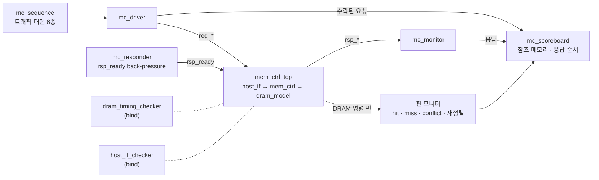

# 검증 계획과 결과

`mem_ctrl`을 무엇으로, 어떤 규칙으로 검증하는지, 그리고 그 결과를 정리한다. 수치는 모두 commit `2eabd33` 기준이다(Verilator 5.052, WSL Ubuntu).

## 구조



- **bind 체커 두 개**는 RTL과 TB를 고치지 않고 [`tb/mc_bind.sv`](../tb/mc_bind.sv)로 붙는다. directed TB(`make sim`)와 랜덤 TB가 같은 체커를 쓰고, 시뮬레이션이 끝날 때 체커 결과가 판정에 들어간다.
- **랜덤 TB**는 UVM의 역할 구분을 라이브러리 없이 SV class로 옮겼다. 클래스는 [`tb/mc_tb_pkg.sv`](../tb/mc_tb_pkg.sv)에, top은 [`tb/tb_mem_ctrl_rand.sv`](../tb/tb_mem_ctrl_rand.sv)에 있다.
- **directed TB**([`tb/tb_mem_ctrl.sv`](../tb/tb_mem_ctrl.sv))는 시나리오 5개를 유지한다.

## 1. DRAM 타이밍 · 프로토콜 체커

[`tb/dram_timing_checker.sv`](../tb/dram_timing_checker.sv)는 `dram_model`의 명령 핀만 보고 open row와 명령 시각을 따로 재구성한다. `mem_ctrl` 내부는 읽지 않는다. 그래서 스케줄러 버그가 스케줄러 자신의 bookkeeping 뒤에 숨지 못한다.

간격은 두 이벤트를 샘플한 클럭 엣지 사이의 사이클 수다.

| 규칙 | 조건 | 판정 |
| --- | --- | --- |
| tRCD | ACT → 같은 뱅크 RD/WR ≥ 3 | 위반 |
| tRP | PRE → 같은 뱅크 ACT ≥ 3, PRE → REF ≥ 3 | 위반 |
| tRAS | ACT → PRE ≥ 6 | 위반 |
| tRC | ACT → 같은 뱅크 ACT ≥ 9 | 위반 |
| tWR | WR → PRE ≥ 2 | 위반 |
| tRFC | REF → 다음 명령 ≥ 12 | 위반 |
| tCL | RD → `data_valid` = 3 (정확히 tCL + 1, [스펙](spec.md) 2절) | 위반 |
| 프로토콜 5종 | 열린 뱅크에 ACT, 닫힌 뱅크에 RD/WR, 열리지 않은 row에 RD/WR, RD 없는 `data_valid`, 데이터가 오지 않은 RD | 위반 |
| REF 때 열린 row | 모든 뱅크가 precharge되기 전에 REF | waived |
| Refresh debt > 8 | 지난 tREFI 주기 수 − 발행한 REF 수 > 8 | waived |

마지막 두 항목은 v1이 실제로 어기는 알려진 문제다.
- v1은 PREA 없이 REF를 내고, 모델이 열린 row를 닫는다.
- `refi_cnt`는 REF가 끝난 뒤에야 다시 장전되므로 REF가 점점 늦어진다.

체커는 이 둘을 숨기지 않고 따로 세어 보고한다(waived). 고치면 `WAIVE_REF_OPEN`, `WAIVE_REF_DEBT`를 0으로 바꿔 위반으로 센다. refresh debt 한도 8은 DDR4가 허용하는 REF postpone 개수를 빌린 값이다.

`--assert` 없이 빌드하면 assertion이 꺼져서 체커가 아무것도 잡지 못한 채 통과할 수 있다. 이를 막으려고 시작할 때 assertion이 켜졌는지 확인하고, 꺼져 있으면 실패로 보고한다.

## 2. 호스트 valid/ready SVA

[`tb/host_if_checker.sv`](../tb/host_if_checker.sv)

| 이름 | 종류 | 내용 |
| --- | --- | --- |
| `a_req_hold` | assert, 호스트 규칙 | `req_ready` 전까지 `req_valid`와 payload 유지 |
| `a_rsp_hold` | assert | `rsp_ready` 전까지 `rsp_valid`와 `rsp_rdata` 유지 |
| `a_known` | assert | 리셋 뒤 handshake 출력에 X/Z 없음 (4-state 시뮬레이터에서 의미가 있다) |
| `a_rsp_err` | assert | v1은 `rsp_err`를 내지 않음 |
| `c_req_stall` · `c_req_b2b` · `c_rsp_stall` · `c_rsp_stall_16` · `c_rsp_b2b_4` | cover | 요청 대기, 연속 수락, 응답 대기, 16사이클 이상 응답 대기, 응답 4연속 |

## 3. 랜덤 TB

| class | 역할 |
| --- | --- |
| `mc_sequence` | 패턴별 주소를 만든다. 최근 쓴 주소를 일정 비율로 다시 써서 RAW · WAW를 만든다 |
| `mc_driver` | 하강 엣지에서 `req_*`를 바꾸고, 상승 엣지의 `req_valid && req_ready`로 수락 시점을 기록한다. 연속 수락도 된다 |
| `mc_responder` | `rsp_ready`를 1–24사이클씩 랜덤하게 내린다 |
| `mc_monitor` | 호스트가 받은 응답을 모은다 |
| `mc_scoreboard` | 요청을 수락하는 순간 참조 메모리로 응답을 예측하고, 응답 순서 · 데이터 · `rsp_err`를 비교한다 |
| `mc_coverage` | 기능 bin 17개 |
| `mc_env` | 생성, 실행, hang 감시(4,000사이클 무응답), 보고, CSV 기록 |

TB top의 DRAM 핀 모니터는 RD/WR마다 두 가지를 한다.
- **분류**: 그 RD/WR를 hit, miss, conflict로 나눈다. 직전 열 명령 이후 그 뱅크에 ACT가 없었으면 hit, ACT만 있었으면 miss, PRE 뒤 ACT가 있었으면 conflict다.
- **짝짓기**: 그 RD/WR를 주소와 방향이 같은 가장 오래된 대기 요청과 짝짓는다.
  - 더 오래된 요청이 아직 자기 RD/WR를 기다리는데 이 요청이 먼저 나가면 **재정렬**로 센다. 뱅크가 다르면 합법이다.
  - 짝이 없는 명령, 그리고 자기 RD/WR보다 먼저 온 응답은 오류다.

**기대값 예측 근거**
- 같은 주소의 요청은 같은 뱅크로 간다.
- 뱅크 엔진은 한 번에 요청 하나를, 오래된 것부터 처리한다.
- 그래서 수락 순서대로 참조 메모리를 갱신하면 각 read의 기대값이 정해진다.
- write의 응답 데이터는 0이다. 써 본 적 없는 주소의 read는 모델의 리셋 값인 0을 기대한다.

**난수**: xorshift64*로 직접 만든다. seed가 같으면 시뮬레이터와 무관하게 같은 요청열이 나온다. driver, responder, sequence는 각자 다른 seed를 쓴다.

### 트래픽 패턴

| 패턴 | 주소 | 성격 |
| --- | --- | --- |
| `seq` | 연속 주소 (col → row → bank 순) | 같은 row가 이어져 hit가 많다 |
| `rowhit` | 뱅크마다 고정 row 하나, col은 랜덤 | hit가 가장 많고 뱅크가 고르게 섞인다 |
| `mixed` | 요청마다 나머지 다섯 패턴 중 하나 | 혼합 |
| `rand` | 14비트 주소 균등 랜덤 | 대부분 conflict |
| `hotbank` | 80%가 bank 0, row는 랜덤 | 한 뱅크에 conflict가 몰린다 |
| `stride` | 16 word 간격 = 같은 뱅크의 다음 row | 거의 전부 conflict |

공통 설정은 다음과 같고, plusarg로 바꿀 수 있다.

| 항목 | 값 | plusarg |
| --- | --- | --- |
| read 비율 | 50% | `+RD_PCT` |
| 요청 사이 idle | 0–2사이클 | `+GAP_MAX` |
| `rsp_ready` stall | 사이클마다 10% 확률로 시작, 길이 1–24사이클 | `+BP_PCT`, `+BP_MAX` |
| 최근 쓴 주소 재사용 | 20% | `+REUSE_PCT` |

## 4. 회귀 결과

`make regress SEEDS=50 N=5000`은 패턴 6 × seed 50 × 요청 5,000으로 모두 300회, 150만 요청이다. WSL에서 약 70초 걸린다.

| 패턴 | 실행 | 요청 | PASS | 데이터 불일치 | 규칙 위반 | waived (알려진 refresh 문제) |
| --- | ---: | ---: | ---: | ---: | ---: | ---: |
| seq | 50 | 250,000 | 50/50 | 0 | 0 | 18,814 |
| rowhit | 50 | 250,000 | 50/50 | 0 | 0 | 39,164 |
| mixed | 50 | 250,000 | 50/50 | 0 | 0 | 52,966 |
| rand | 50 | 250,000 | 50/50 | 0 | 0 | 50,145 |
| hotbank | 50 | 250,000 | 50/50 | 0 | 0 | 48,717 |
| stride | 50 | 250,000 | 50/50 | 0 | 0 | 26,722 |

### 기능 커버리지

17개 bin이 모두 맞았다. 오른쪽 열은 그 bin을 한 번이라도 맞힌 실행 수다.

| bin | 300회 합계 | 맞힌 실행 |
| --- | ---: | ---: |
| read hit / miss / conflict | 213,110 / 117,749 / 419,765 | 300 / 300 / 250 |
| write hit / miss / conflict | 212,161 / 118,145 / 419,070 | 300 / 300 / 250 |
| 4개 이상 in flight | 1,235,699 | 300 |
| 8개 이상 in flight | 506,407 | 300 |
| 15개 in flight (tag 한도) | 31,728 | 195 |
| 네 뱅크 모두 in flight | 368,600 | 200 |
| 같은 주소 RAW · WAW | 38,529 · 38,416 | 300 · 300 |
| tag 한도에서 요청 대기 | 151,417 | 190 |
| 응답이 16사이클 이상 대기 | 122,411 | 300 |
| 응답이 남은 채 REF | 72,984 | 300 |
| `rsp_ready`가 내려간 채 REF | 59,692 | 300 |
| 재정렬 (뒤에 온 요청의 RD/WR가 먼저 나감) | 332,014 | 300 |

conflict가 없는 50회는 `rowhit`이다. 뱅크마다 row가 하나뿐이라 PRE가 나오지 않는다. 15개 in flight와 tag 한도 bin은 지연이 짧은 패턴에서는 맞지 않는다.

### 성능 기준선

<p align="center"></p>

| 패턴 | row hit | 데이터 버스 사용률 | latency 평균 / p99 | REF 간격 평균 | 최대 refresh debt |
| --- | ---: | ---: | ---: | ---: | ---: |
| seq | 65.0% | 12.3% | 36.0 / 76.3 | 109.1 | 271 |
| rowhit | 84.4% | 29.1% | 31.6 / 85.0 | 87.9 | 76 |
| mixed | 14.9% | 13.8% | 43.1 / 86.9 | 120.2 | 281 |
| rand | 3.1% | 17.4% | 42.4 / 88.9 | 113.7 | 202 |
| hotbank | 1.8% | 8.7% | 50.2 / 90.7 | 133.6 | 478 |
| stride | 0.9% | 7.5% | 51.9 / 90.8 | 135.0 | 549 |

<sub>값은 seed 50개 평균이고, 최대 refresh debt만 최댓값이다. latency는 요청 수락에서 응답까지의 사이클 수다. 데이터 버스 사용률은 첫 수락부터 마지막 응답까지의 사이클 중 RD 데이터나 WR 데이터가 오간 사이클의 비율이다. 그래프는 `python tools/regress_report.py build/regress/regress.csv --plots docs/images`로 그렸다(matplotlib 필요).</sub>

- **Refresh가 밀린다.**
  - 부하가 걸리면 REF 간격이 tREFI(64)의 1.4–2.1배가 되고, 아직 내지 못한 REF가 최대 549개까지 쌓인다.
  - directed 시나리오에서는 평균 84사이클, debt 3이라 이 규모가 보이지 않았다.
  - 원인은 두 가지다. drain-then-REF는 큐가 빌 때까지 REF를 미룬다. 또 `refi_cnt`는 REF가 끝난 뒤에야 다시 장전된다.
  - 실제 DRAM이라면 retention 위반이다.
- **데이터 버스가 비어 있다.**
  - 사용률이 7.5–29.1%에 그친다.
  - 사이클당 명령 1개와 read in-flight 1개가 상한을 정한다.
  - 이 값이 읽기 파이프라이닝과 행/열 명령 버스 분리의 기준선이다.
- **row hit는 트래픽이 정한다.** open-page의 이득은 지역성이 있는 `seq` · `rowhit`에서만 나온다.

## 5. 코드 커버리지

`make cov`는 directed 1회와 랜덤 18회(패턴 6 × seed 3 × 요청 5,000)를 각각 커버리지 빌드로 돌린다. 그 결과를 [`tools/cov_summary.py`](../tools/cov_summary.py)가 합친다.
- 합치는 기준은 소스 지점이다. 두 TB의 계층 경로가 달라서 경로는 무시한다.
- 지점 하나는 어느 실행에서든 한 번 맞으면 덮인 것으로 센다.

| 모듈 | Line | Branch | Toggle |
| --- | ---: | ---: | ---: |
| `mem_ctrl` | 94.1% → **97.1%** (33/34) | 91.7% → **94.4%** (68/72) | 61.8% → **95.9%** (1,483/1,546) |
| `dram_model` | 100.0% → **100.0%** (13/13) | 83.3% → **83.3%** (15/18) | 83.3% → **99.0%** (297/300) |
| `mem_ctrl_top` | – | – | 83.2% → **98.3%** (521/530) |
| `host_if` | – | – | 82.6% → **98.5%** (335/340) |
| RTL 전체 | 95.7% → **97.9%** (46/47) | 90.0% → **92.2%** (83/90) | 71.0% → **97.1%** (2,636/2,716) |

<sub>화살표 왼쪽은 directed만, 오른쪽은 랜덤을 더한 값이다. Verilator의 expression 커버리지도 나오지만 표에서 뺐다. 루프 안의 식에서 분명히 실행된 항(예: `!disp_valid`)까지 미도달로 세는 경우가 있어서다.</sub>

남은 구멍은 `python3 tools/cov_summary.py --holes mem_ctrl build/cov/*.dat`로 볼 수 있다.

| 위치 | 이유 |
| --- | --- |
| `mem_ctrl.sv:318` PRE_WAIT → IDLE | v1은 다른 row를 열 때만 PRE를 내므로 ACT 없이 IDLE로 가는 길은 쓰이지 않는다. close-page 정책이 생기면 쓰인다 |
| `mem_ctrl.sv:290`, `:298`, `:302` | `tRP > 0 ? tRP - 1 : 0` 같은 파라미터 상수 조건이라 else 쪽은 구조상 도달하지 않는다 |
| `mem_ctrl.sv:310` | `case`의 default. `win_valid`일 때 `win_cmd`는 NOP나 REF가 아니다 |
| `dram_model.sv:93`, `:110`, `:133` | 닫힌 row 읽기, 열린 뱅크에 다른 row ACT, 닫힌 row에 WR. 컨트롤러가 이런 명령을 내지 않았다는 뜻이다. 모델을 직접 모는 negative test로 닫는다 |

랜덤 회귀로 닫힌 이전 구멍은 다음과 같다.

| 이전 구멍 | 랜덤 회귀 결과 |
| --- | --- |
| out-of-order dispatch | 재정렬 332,014회. 응답 순서와 데이터는 모두 일치했다 |
| write-hit 경로 | 212,161회 |
| REF와 back-pressure의 겹침 | 59,692회 |
| 타이밍 assertion | bind 체커로 들어왔다 |
| random traffic과 coverage bin | 이 문서의 3–4절 |

## 6. 실행

```bash
make sim                                   # directed 5개 + bind 체커
make sim-rand PATTERN=hotbank SEED=7 N=5000 # 랜덤 1회
make regress SEEDS=50 N=5000               # 6 패턴 × 50 seed, build/regress/regress.csv
make cov N=5000                            # 커버리지: directed만 / directed + 랜덤
python tools/regress_report.py build/regress/regress.csv --plots docs/images   # 그래프
```

실패한 랜덤 실행은 `build/regress/<패턴>_seed<번호>.log`에 로그가 남는다. 같은 `+PATTERN`과 `+SEED`로 다시 돌리면 같은 요청열이 재현된다.

## 7. 한계

- class 기반 랜덤 TB는 Verilator 5.052에서만 돌려 봤다. ModelSim-Altera 무료판은 class와 concurrent SVA 지원이 제한적일 수 있다. directed TB는 체커 없이도 돈다.
- 체커가 보는 타이밍은 스펙에 있는 7종뿐이다. tCCD · tRRD · tFAW · tWTR는 스펙에 넣을 때 체커에도 함께 넣는다.
- refresh 두 항목은 waived 상태다. 고친 뒤 waiver를 끈다.
- `dram_model` 오류 경로를 일부러 일으키는 negative test가 아직 없다.
- 성능 수치는 자체 축소 타이밍(tRCD 3, tCL 2 등) 기준이다. 절대값보다 패턴 사이, 그리고 다음 버전과의 비교에 쓴다.
